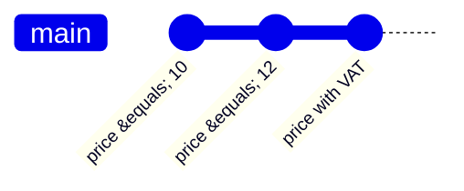

# Module 1 · Why version control? Snapshots instead of final_v2_REALLY_final.py

Without version control people copy files: app_old.py, app_backup.py, app_final_v2.py. Nobody knows which one is current, what changed, or why.

Git saves SNAPSHOTS of your whole project. Each snapshot (a commit) records WHAT changed, WHO changed it, WHEN, and WHY (the message). You can look at any old version, compare versions, and go back, and a whole team can work in parallel.

> 🧠 **Picture it:** A photo album of your project: every commit is a photo with a caption.

**Why it matters:** Every software team uses Git. "Do you know Git?" is assumed, not asked.

## See it



## Try it yourself

Open **Git Bash** (Windows) or a terminal (macOS/Linux) in an empty practice folder and type along. Lines starting with `$` are commands; the lines below them are what Git prints.

```bash
mkdir project && cd project
```

### 1. Three versions of a file, saved as three snapshots (commits)

```console
$ git init
Initialized empty Git repository in ~/project/.git/
$ echo "price = 10" > shop.py
$ git add shop.py
$ git commit -m "Add shop with a fixed price"
[main (root-commit) f8b0491] Add shop with a fixed price
 1 file changed, 1 insertion(+)
 create mode 100644 shop.py
$ echo "price = 12" > shop.py
$ git commit -am "Raise the price to 12"
[main cacef8e] Raise the price to 12
 1 file changed, 1 insertion(+), 1 deletion(-)
$ echo "price = 12 * 1.19  # with VAT" > shop.py
$ git commit -am "Show prices with VAT"
[main 0c43fe3] Show prices with VAT
 1 file changed, 1 insertion(+), 1 deletion(-)
```

### 2. The history: what changed, when, by whom, and why

```console
$ git log --oneline
0c43fe3 Show prices with VAT
cacef8e Raise the price to 12
f8b0491 Add shop with a fixed price
```

```console
$ git log -1 --format="%h | %an | %ad | %s" --date=short
0c43fe3 | Vishal | 2026-10-27 | Show prices with VAT
```

### 3. Look at any old version without losing the new one

```console
$ git show HEAD~2:shop.py
price = 10
$ git show HEAD~1:shop.py
price = 12
$ cat shop.py
price = 12 * 1.19  # with VAT
```

### 4. Compare two versions

```console
$ git diff HEAD~2 HEAD
diff --git a/shop.py b/shop.py
index b4a49e7..6e1fd89 100644
--- a/shop.py
+++ b/shop.py
@@ -1 +1 @@
-price = 10
+price = 12 * 1.19  # with VAT
```

Git is DISTRIBUTED: every clone has the full history, so you can work offline.

> ⚠️ **Watch out:** Git is not GitHub. Git is the tool on your laptop; GitHub is a website that hosts Git repositories.

**In real jobs:** Every change you make at work is a commit, reviewed in a pull request.

## Interview question

**What is Git and why use it?**

A distributed version control system: it tracks every change with who/when/why, lets you go back, and lets many people work in parallel.

[← Back to the module](README.md)
