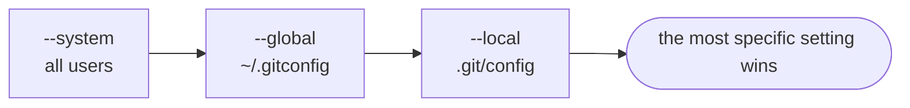

# Module 1 · Install and configure Git

Install: Windows   https://git-scm.com/download/win   (includes Git Bash) macOS     xcode-select --install    or   brew install git Linux     sudo apt install git

Then tell Git who you are. Every commit stores this name and email:

```text
git config --global user.name  "Your Name"
git config --global user.email "you@example.com"
git config --global init.defaultBranch main
git config --global core.editor "code --wait"     # VS Code as the editor
```

Settings live at three levels; the most specific one wins: --system  every user on the machine --global  you (~/.gitconfig) --local   one repository (.git/config)

> 🧠 **Picture it:** Three layers of stickers: system, then global, then local on top.

**Why it matters:** A wrong email means your commits aren't linked to your GitHub account.

## See it



## Try it yourself

Open **Git Bash** (Windows) or a terminal (macOS/Linux) in an empty practice folder and type along. Lines starting with `$` are commands; the lines below them are what Git prints.

```bash
mkdir project && cd project
```

### 1. Which Git do you have?

```console
$ git --version
git version 2.55.0.windows.5
```

### 2. Who am I? Your global settings

```console
$ git config --global user.name
Vishal
$ git config --global user.email
vishal@example.com
$ git config --global init.defaultBranch
main
```

### 3. A LOCAL setting overrides the global one for this repository only

```console
$ git init
Initialized empty Git repository in ~/project/.git/
$ git config --local user.email "vishal@company.com"
$ git config user.email
vishal@company.com
$ git config --show-scope --get-all user.email
global	vishal@example.com
local	vishal@company.com
```

### 4. Getting help

```text
  git help commit        full manual page
```

```text
  git commit -h          short summary of the options
```

> ⚠️ **Watch out:** Use your work email in work repos: set it with --local inside that repo.

**In real jobs:** Day one: install Git, set name/email, add an SSH key to GitHub.

## Interview question

**Where does Git store configuration?**

System, global (~/.gitconfig) and local (.git/config); local wins.

[← Back to the module](README.md)
