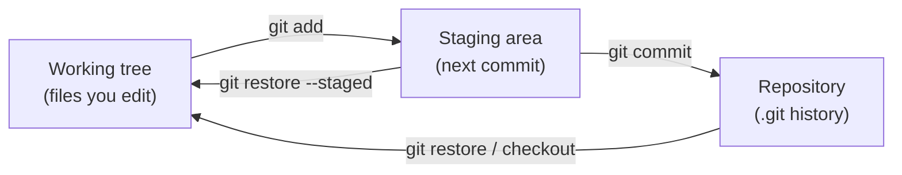

# Module 2 · The three areas: working tree -> staging area -> repository

```text
working tree   the files you edit
staging area   what goes into the NEXT commit   (git add puts it here)
repository     the saved snapshots              (git commit saves it here)
```

git status tells you, for every file, which area it's in.

> 🧠 **Picture it:** Packing a parcel: the desk (working tree), the open box (staging), the sealed, labelled parcel on the shelf (commit).

**Why it matters:** The staging area lets you commit PART of your work: one clean commit per idea, even if you changed five things.

## See it



## Try it yourself

Open **Git Bash** (Windows) or a terminal (macOS/Linux) in an empty practice folder and type along. Lines starting with `$` are commands; the lines below them are what Git prints.

```bash
mkdir project && cd project
```

**Setup** (copy and paste this first):

```bash
git init
```

### 1. A new file is UNTRACKED: Git sees it but doesn't save it

```console
$ echo "print('hello')" > app.py
$ git status --short
?? app.py
```

### 2. git add puts it in the STAGING AREA (?? -> A)

```console
$ git add app.py
$ git status --short
A  app.py
```

### 3. git commit saves the staged snapshot in the REPOSITORY

```console
$ git commit -m "Add hello app"
[main (root-commit) 5798825] Add hello app
 1 file changed, 1 insertion(+)
 create mode 100644 app.py
$ git status --short
$ git log --oneline
5798825 Add hello app
```

### 4. Edit two files, but commit only one of them

```console
$ echo "print('hello, world')" > app.py
$ echo "debug notes" > notes.txt
$ git status --short
 M app.py
?? notes.txt
$ git add app.py
$ git status --short
M  app.py
?? notes.txt
$ git commit -m "Greet the whole world"
[main bdc3023] Greet the whole world
 1 file changed, 1 insertion(+), 1 deletion(-)
$ git status --short
?? notes.txt
```

Status codes:  ?? untracked   A added   M modified (left column = staged, right = not staged)

> ⚠️ **Watch out:** git commit only saves what you staged; changes made after git add need another git add.

**In real jobs:** "Commit only the fix, not the debug prints" is a daily habit.

## Interview question

**What is the staging area (index)?**

The snapshot being prepared for the next commit; git add copies changes into it, git commit saves it.

[← Back to the module](README.md)
