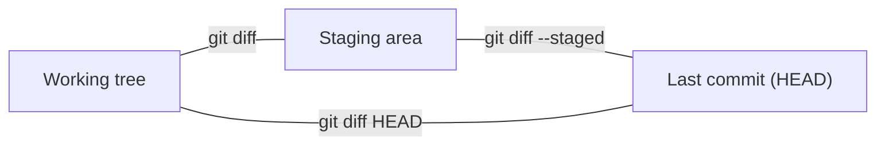

# Module 2 · See what changed: git diff and git log

```text
git diff            working tree vs staging area  (not yet added)
git diff --staged   staging area vs last commit    (what WILL be committed)
git log             the history, newest first
git show <commit>   one commit: message + changes
```

> 🧠 **Picture it:** diff is a red pen on a printout: - lines removed, + lines added.

**Why it matters:** Reviewing your own diff before committing catches debug prints, secrets and mistakes before anyone else sees them.

## See it



## Try it yourself

Open **Git Bash** (Windows) or a terminal (macOS/Linux) in an empty practice folder and type along. Lines starting with `$` are commands; the lines below them are what Git prints.

```bash
mkdir project && cd project
```

**Setup** (copy and paste this first):

```bash
git init
echo "apples = 3" > cart.py
echo "pears = 1" >> cart.py
git add cart.py
git commit -m "Add cart"
```

### 1. Change a line: git diff shows it (not staged yet)

```console
$ echo "apples = 3" > cart.py
$ echo "pears = 5" >> cart.py
$ git diff
diff --git a/cart.py b/cart.py
index 818f11e..881c683 100644
--- a/cart.py
+++ b/cart.py
@@ -1,2 +1,2 @@
 apples = 3
-pears = 1
+pears = 5
```

### 2. After git add, plain diff is empty; --staged shows it

```console
$ git add cart.py
$ git diff
$ git diff --staged --stat
 cart.py | 2 +-
 1 file changed, 1 insertion(+), 1 deletion(-)
$ git commit -m "Buy more pears"
[main 9818223] Buy more pears
 1 file changed, 1 insertion(+), 1 deletion(-)
```

### 3. Read history in different ways

```console
$ git log --oneline
9818223 Buy more pears
ad38804 Add cart
$ git log --stat -1
commit 9818223b6ad1ea54cce28112703356878a464895
Author: Vishal <vishal@example.com>
Date:   Tue Oct 27 08:08:00 2026 +0000

    Buy more pears

 cart.py | 2 +-
 1 file changed, 1 insertion(+), 1 deletion(-)
$ git show --stat HEAD~1
commit ad3880488e30698af233bcb3ad2c8d992aae8d37
Author: Vishal <vishal@example.com>
Date:   Tue Oct 27 08:03:00 2026 +0000

    Add cart

 cart.py | 2 ++
 1 file changed, 2 insertions(+)
```

> ⚠️ **Watch out:** git diff alone shows nothing for staged changes; use git diff --staged.

**In real jobs:** Read git diff --staged before every commit; pull requests show the same diff.

## Interview question

**git diff vs git diff --staged?**

diff = unstaged changes vs the index; --staged = staged changes vs the last commit.

[← Back to the module](README.md)
