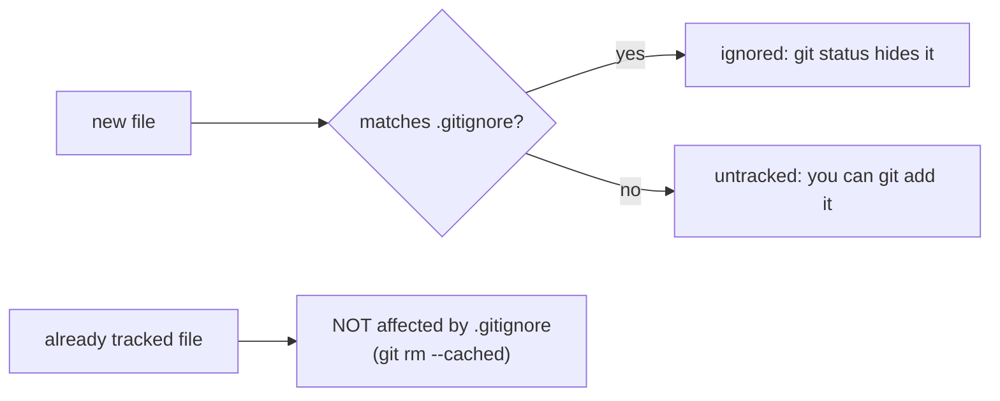

# Module 2 · .gitignore: keep junk and secrets out of Git

A .gitignore file lists patterns Git should NOT track:

```text
.env              secrets (passwords, API keys)
__pycache__/      generated files
*.log             logs
.venv/            virtual environments
!keep.log         ! = an exception: DO track this one
```

> 🧠 **Picture it:** A bouncer list at the door: anything matching the list doesn't get in.

**Why it matters:** A pushed .env file leaks passwords to everyone who can see the repo.

## See it



## Try it yourself

Open **Git Bash** (Windows) or a terminal (macOS/Linux) in an empty practice folder and type along. Lines starting with `$` are commands; the lines below them are what Git prints.

```bash
mkdir project && cd project
```

**Setup** (copy and paste this first):

```bash
git init
```

### 1. A project with junk next to the code

```console
$ echo "print('shop')" > app.py
$ echo "DB_PASSWORD=secret123" > .env
$ echo "error at 12:01" > server.log
$ mkdir __pycache__
$ echo "bytecode" > __pycache__/app.cpython-312.pyc
$ git status --short --untracked-files=all
?? .env
?? __pycache__/app.cpython-312.pyc
?? app.py
?? server.log
```

### 2. Add a .gitignore: the junk disappears from git status

```console
$ echo ".env" > .gitignore
$ echo "*.log" >> .gitignore
$ echo "__pycache__/" >> .gitignore
$ git status --short --untracked-files=all
?? .gitignore
?? app.py
$ git check-ignore -v server.log
.gitignore:2:*.log	server.log
```

### 3. The classic trap: a file committed BEFORE it was ignored

```console
$ echo "API_KEY=abc" > settings.ini
$ git add settings.ini app.py .gitignore
$ git commit -m "Add app"
[main (root-commit) 35285df] Add app
 3 files changed, 5 insertions(+)
 create mode 100644 .gitignore
 create mode 100644 app.py
 create mode 100644 settings.ini
$ echo "settings.ini" >> .gitignore
$ echo "API_KEY=new" > settings.ini
$ git status --short
 M .gitignore
 M settings.ini
$ git rm --cached settings.ini
rm 'settings.ini'
$ git commit -am "Stop tracking settings.ini"
[main d9555eb] Stop tracking settings.ini
 2 files changed, 1 insertion(+), 1 deletion(-)
 delete mode 100644 settings.ini
$ git status --short
```

The old API_KEY is still in the history: a leaked secret must be rotated (Module 11).

> ⚠️ **Watch out:** .gitignore only affects UNTRACKED files. A file already committed stays tracked until you run git rm --cached <file>.

**In real jobs:** Every project has a .gitignore (github.com/github/gitignore has templates).

## Interview question

**You added a file to .gitignore but Git still tracks it. Why?**

It was already tracked; remove it from the index with git rm --cached and commit.

[← Back to the module](README.md)
