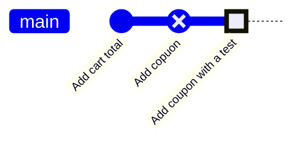

# Module 3 · Small undos: restore and amend

```text
git restore <file>            throw away unstaged changes (back to the staged/committed version)
git restore --staged <file>   unstage (the change stays in your working tree)
git commit --amend            fix the LAST commit: message or forgotten files
```

> 🧠 **Picture it:** restore = undo button for a file; amend = re-taking the last photo.

**Why it matters:** Most mistakes are tiny: a typo in a message, a forgotten file, a debug line. Fix them in seconds instead of piling up "fix typo" commits.

## See it



## Try it yourself

Open **Git Bash** (Windows) or a terminal (macOS/Linux) in an empty practice folder and type along. Lines starting with `$` are commands; the lines below them are what Git prints.

```bash
mkdir project && cd project
```

**Setup** (copy and paste this first):

```bash
git init
echo "def total(items): return sum(items)" > cart.py
git add cart.py
git commit -m "Add cart total"
```

### 1. Throw away a bad edit: git restore

```console
$ echo "def total(items): return 0  # broken experiment" > cart.py
$ git status --short
 M cart.py
$ git restore cart.py
$ git status --short
$ cat cart.py
def total(items): return sum(items)
```

### 2. Staged too much? git restore --staged unstages it (the edit stays)

```console
$ echo "print('debug')" > debug.py
$ git add debug.py
$ git status --short
A  debug.py
$ git restore --staged debug.py
$ git status --short
?? debug.py
```

### 3. Typo in the last message and a forgotten file: git commit --amend

```console
$ echo "def apply(code): return 0.1" > coupon.py
$ git add coupon.py
$ git commit -m "Add copuon"
[main df86023] Add copuon
 1 file changed, 1 insertion(+)
 create mode 100644 coupon.py
$ git log --oneline
df86023 Add copuon
109a184 Add cart total
$ echo "def test_apply(): assert apply('X') == 0.1" > test_coupon.py
$ git add test_coupon.py
$ git commit --amend -m "Add coupon with a test"
[main 8503494] Add coupon with a test
 Date: Tue Oct 27 08:12:00 2026 +0000
 2 files changed, 2 insertions(+)
 create mode 100644 coupon.py
 create mode 100644 test_coupon.py
$ git log --oneline --stat -1
8503494 Add coupon with a test
 coupon.py      | 1 +
 test_coupon.py | 1 +
 2 files changed, 2 insertions(+)
```

The amended commit has a NEW ID: never amend commits others already pulled.

> ⚠️ **Watch out:** git restore <file> deletes your unstaged edits for good. And only amend commits you haven't pushed yet: amending creates a NEW commit ID.

**In real jobs:** "Oops, forgot the test file" -> git add test_x.py; git commit --amend --no-edit.

## Interview question

**How do you change the message of your last commit?**

git commit --amend -m "new message" (only if it isn't pushed/shared yet).

[← Back to the module](README.md)
