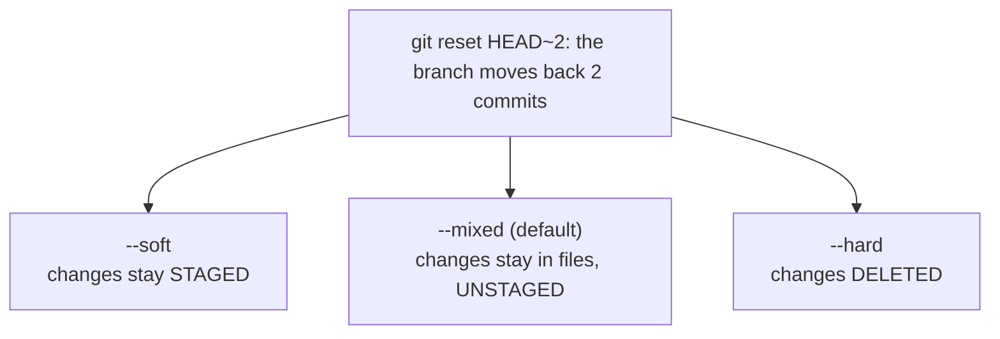

# Module 3 · git reset: move the branch back (soft, mixed, hard)

git reset <commit> moves your current branch to <commit>. The mode decides what happens to the changes from the commits you "removed":

```text
--soft    keep them STAGED          (ready to commit again, e.g. squash 3 commits into 1)
--mixed   keep them in the WORKING TREE, unstaged   (the default)
--hard    THROW THEM AWAY           (working tree = that commit; careful!)
```

> 🧠 **Picture it:** Moving a bookmark back in a book. soft: the later pages stay on your desk in a neat pile; mixed: loose on the desk; hard: into the shredder.

**Why it matters:** reset is the power tool for rewriting LOCAL history: undo commits, squash work-in-progress, start over.

## See it



## Try it yourself

Open **Git Bash** (Windows) or a terminal (macOS/Linux) in an empty practice folder and type along. Lines starting with `$` are commands; the lines below them are what Git prints.

```bash
mkdir project && cd project
```

**Setup** (copy and paste this first):

```bash
git init
echo "v1" > app.txt
git add app.txt
git commit -m "Version 1"
echo "v2" > app.txt
git commit -qam "Version 2"
echo "v3" > app.txt
git commit -qam "Version 3"
```

### git reset --soft HEAD~2   (back from Version 3 to Version 1)

```console
$ git reset --soft HEAD~2
$ git log --oneline
bcf013a Version 1
$ git status --short
M  app.txt
$ cat app.txt
v3
```

**Setup** (copy and paste this first):

```bash
git init
echo "v1" > app.txt
git add app.txt
git commit -m "Version 1"
echo "v2" > app.txt
git commit -qam "Version 2"
echo "v3" > app.txt
git commit -qam "Version 3"
```

### git reset --mixed HEAD~2   (back from Version 3 to Version 1)

```console
$ git reset --mixed HEAD~2
Unstaged changes after reset:
M	app.txt
$ git log --oneline
bcf013a Version 1
$ git status --short
 M app.txt
$ cat app.txt
v3
```

**Setup** (copy and paste this first):

```bash
git init
echo "v1" > app.txt
git add app.txt
git commit -m "Version 1"
echo "v2" > app.txt
git commit -qam "Version 2"
echo "v3" > app.txt
git commit -qam "Version 3"
```

### git reset --hard HEAD~2   (back from Version 3 to Version 1)

```console
$ git reset --hard HEAD~2
HEAD is now at bcf013a Version 1
$ git log --oneline
bcf013a Version 1
$ git status --short
$ cat app.txt
v1
```

soft: changes staged (M in the left column) | mixed: unstaged (right column) | hard: gone

> ⚠️ **Watch out:** Don't reset commits that are already pushed and shared; use git revert. reset --hard also deletes uncommitted work (reflog can't save that).

**In real jobs:** git reset --soft HEAD~3 then one clean commit before opening a PR.

## Interview question

**Difference between reset --soft, --mixed and --hard?**

All move the branch; soft keeps changes staged, mixed keeps them unstaged, hard discards them.

[← Back to the module](README.md)
