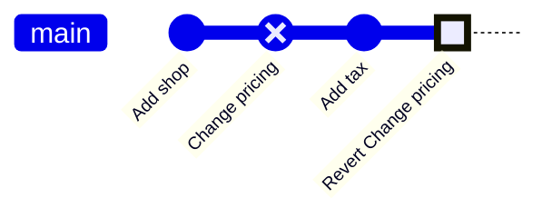

# Module 3 · Safe undo for shared history (revert) and the safety net (reflog)

```text
git revert <commit>   makes a NEW commit that undoes <commit>. History is kept,
                      so it's safe on branches others have pulled (main!).
git reflog            a diary of where HEAD has been. "Lost" commits after a
                      reset or a deleted branch are still there for ~90 days.
```

> 🧠 **Picture it:** revert = a correction notice printed in the next issue of a newspaper; reflog = the CCTV recording of everything HEAD did.

**Why it matters:** On shared branches you must never rewrite history; and almost nothing committed is ever truly lost if you know reflog.

## See it



## Try it yourself

Open **Git Bash** (Windows) or a terminal (macOS/Linux) in an empty practice folder and type along. Lines starting with `$` are commands; the lines below them are what Git prints.

```bash
mkdir project && cd project
```

**Setup** (copy and paste this first):

```bash
git init
echo "price = 10" > shop.txt
git add shop.txt
git commit -m "Add shop"
echo "price = 0" > shop.txt
git commit -qam "Change pricing"
echo "tax = 0.19" > tax.txt
git add tax.txt
git commit -qm "Add tax"
```

### 1. 'Change pricing' broke production. Undo it WITHOUT rewriting history

```console
$ git log --oneline
62d2edc Add tax
dbce891 Change pricing
29988e9 Add shop
$ git revert --no-edit HEAD~1
[main fb0eb65] Revert "Change pricing"
 Date: Tue Oct 27 08:08:00 2026 +0000
 1 file changed, 1 insertion(+), 1 deletion(-)
$ git log --oneline
fb0eb65 Revert "Change pricing"
62d2edc Add tax
dbce891 Change pricing
29988e9 Add shop
$ cat shop.txt
price = 10
```

### 2. Disaster: reset --hard threw away 3 commits...

```console
$ git reset --hard HEAD~3
HEAD is now at 29988e9 Add shop
$ git log --oneline
29988e9 Add shop
```

### 3. ...reflog remembers where HEAD was. Jump back:

```console
$ git reflog -5
29988e9 HEAD@{0}: reset: moving to HEAD~3
fb0eb65 HEAD@{1}: revert: Revert "Change pricing"
62d2edc HEAD@{2}: commit: Add tax
dbce891 HEAD@{3}: commit: Change pricing
29988e9 HEAD@{4}: commit (initial): Add shop
$ git reset --hard HEAD@{1}
HEAD is now at fb0eb65 Revert "Change pricing"
$ git log --oneline
fb0eb65 Revert "Change pricing"
62d2edc Add tax
dbce891 Change pricing
29988e9 Add shop
```

### 4. A deleted branch can be brought back too

```console
$ git switch -c experiment
Switched to a new branch 'experiment'
$ echo "banner = True" > banner.txt
$ git add banner.txt
$ git commit -m "Try discount banner"
[experiment 29f4e41] Try discount banner
 1 file changed, 1 insertion(+)
 create mode 100644 banner.txt
$ git switch main
Switched to branch 'main'
$ git branch -D experiment
Deleted branch experiment (was 29f4e41).
$ git reflog -3
fb0eb65 HEAD@{0}: checkout: moving from experiment to main
29f4e41 HEAD@{1}: commit: Try discount banner
fb0eb65 HEAD@{2}: checkout: moving from main to experiment
$ git branch experiment HEAD@{1}
$ git log --oneline -1 experiment
29f4e41 Try discount banner
```

> ⚠️ **Watch out:** reflog is local only (not pushed) and can't recover work that was never committed. Commit often!

**In real jobs:** Production bug from yesterday's merge -> git revert it, push, deploy.

## Interview question

**reset vs revert?**

reset moves the branch and rewrites history (local only); revert adds a new undo commit and is safe for shared branches.

[← Back to the module](README.md)
