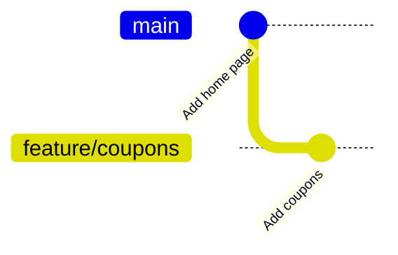

# Module 4 · Branches are just movable pointers

A branch is a tiny file containing ONE commit ID. Creating a branch copies nothing; it's instant. HEAD points to the branch you're on. Each new commit moves that branch forward.

```text
git branch                 list branches (* = current)
git switch -c feature/x    create a branch and switch to it
git switch main            go back
git branch -d feature/x    delete a merged branch
```

> 🧠 **Picture it:** Sticky notes on a timeline of photos: each note (branch) marks one photo; HEAD is the note you're holding.

**Why it matters:** Branches let you build a feature without breaking main, and let 10 developers work at the same time.

## See it



## Try it yourself

Open **Git Bash** (Windows) or a terminal (macOS/Linux) in an empty practice folder and type along. Lines starting with `$` are commands; the lines below them are what Git prints.

```bash
mkdir project && cd project
```

**Setup** (copy and paste this first):

```bash
git init
echo "home page" > home.txt
git add home.txt
git commit -m "Add home page"
```

### 1. A branch is a file with a commit ID in it

```console
$ git branch
* main
$ git rev-parse main
cbae48bca8715080fc257b04445e10641510e5bf
$ cat .git/HEAD
ref: refs/heads/main
```

### 2. Create a feature branch: nothing is copied, it's instant

```console
$ git switch -c feature/coupons
Switched to a new branch 'feature/coupons'
$ git branch
* feature/coupons
  main
$ echo "coupons" > coupons.txt
$ git add coupons.txt
$ git commit -m "Add coupons"
[feature/coupons dea136f] Add coupons
 1 file changed, 1 insertion(+)
 create mode 100644 coupons.txt
$ git log --oneline --all --graph
* dea136f Add coupons
* cbae48b Add home page
```

### 3. Switching branches changes the files in your folder

```console
$ git switch main
Switched to branch 'main'
$ git status --short
$ git ls-files
home.txt
$ git switch feature/coupons
Switched to branch 'feature/coupons'
$ git ls-files
coupons.txt
home.txt
```

> ⚠️ **Watch out:** Switching branches with uncommitted changes carries them along (or Git refuses). Commit or stash first (Module 8).

**In real jobs:** One branch per ticket: feature/JIRA-123-coupon-codes.

## Interview question

**What is a branch in Git?**

A lightweight movable pointer to a commit; HEAD points to the current branch, and each commit moves it forward.

[← Back to the module](README.md)
