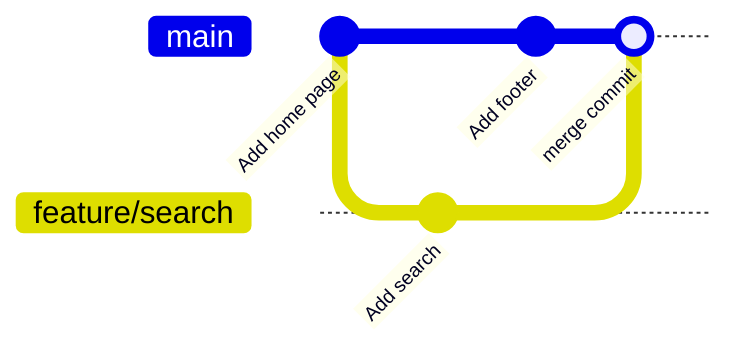

# Module 4 · Merging: fast-forward vs three-way merge

```text
fast-forward   main hasn't moved since you branched -> Git just slides main forward.
               No new commit; history stays a straight line.
three-way      both branches have new commits -> Git combines them in a MERGE COMMIT
               with two parents.
```

```text
git merge feature        merge feature INTO the current branch
git merge --no-ff x      always create a merge commit (keeps the feature visible)
```

> 🧠 **Picture it:** Fast-forward: catching up on the same road. Three-way: two roads joining at a junction (the merge commit).

**Why it matters:** Every pull request ends with a merge; knowing which kind explains the shape of your history.

## See it



## Try it yourself

Open **Git Bash** (Windows) or a terminal (macOS/Linux) in an empty practice folder and type along. Lines starting with `$` are commands; the lines below them are what Git prints.

```bash
mkdir project && cd project
```

### A. FAST-FORWARD: main did not move

**Setup** (copy and paste this first):

```bash
git init
echo "home page" > home.txt
git add home.txt
git commit -m "Add home page"
git switch -c feature/search
echo "search box" > search.txt
git add search.txt
git commit -m "Add search"
```

```console
$ git switch main
Switched to branch 'main'
$ git merge feature/search
Updating cbae48b..bed5ce2
Fast-forward
 search.txt | 1 +
 1 file changed, 1 insertion(+)
 create mode 100644 search.txt
$ git log --oneline --graph --all
* bed5ce2 Add search
* cbae48b Add home page
```

### B. THREE-WAY: main moved too

**Setup** (copy and paste this first):

```bash
git init
echo "home page" > home.txt
git add home.txt
git commit -m "Add home page"
git switch -c feature/search
echo "search box" > search.txt
git add search.txt
git commit -m "Add search"
```

```console
$ git switch main
Switched to branch 'main'
$ echo "footer" > footer.txt
$ git add footer.txt
$ git commit -m "Add footer"
[main 9e81205] Add footer
 1 file changed, 1 insertion(+)
 create mode 100644 footer.txt
$ git merge --no-edit feature/search
Merge made by the 'ort' strategy.
 search.txt | 1 +
 1 file changed, 1 insertion(+)
 create mode 100644 search.txt
$ git log --oneline --graph --all
*   28c942c Merge branch 'feature/search'
|\  
| * bed5ce2 Add search
* | 9e81205 Add footer
|/  
* cbae48b Add home page
$ git log -1 --format="merge commit parents: %p"
merge commit parents: 9e81205 bed5ce2
```

Delete the branch after merging:  git branch -d feature/search

> ⚠️ **Watch out:** Merge INTO the branch you're on: switch to main first, then git merge feature.

**In real jobs:** GitHub's "Merge", "Squash and merge" and "Rebase and merge" buttons.

## Interview question

**What is a fast-forward merge?**

When the target branch has no new commits, Git just moves its pointer forward to the feature tip; no merge commit is created.

[← Back to the module](README.md)
