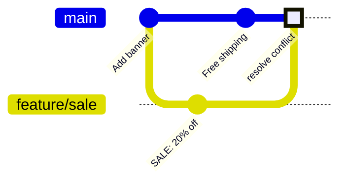

# Module 4 · Merge conflicts: when both branches changed the same lines

Git merges different lines automatically. When BOTH sides changed the SAME lines, it stops and asks you. The file then contains conflict markers:

```text
<<<<<<< HEAD
your branch's version
=======
the other branch's version
>>>>>>> feature
```

To resolve: edit the file to the final content (remove the markers), git add it, then git commit (or git merge --abort to cancel).

> 🧠 **Picture it:** Two editors changed the same sentence; Git hands you both versions and asks: which one, or a mix?

**Why it matters:** Conflicts are normal in teams; resolving them calmly is a core skill.

## See it



## Try it yourself

Open **Git Bash** (Windows) or a terminal (macOS/Linux) in an empty practice folder and type along. Lines starting with `$` are commands; the lines below them are what Git prints.

```bash
mkdir project && cd project
```

**Setup** (copy and paste this first):

```bash
git init
echo "Welcome to our shop" > banner.txt
git add banner.txt
git commit -m "Add banner"
git switch -c feature/sale
echo "Big SALE: 20% off" > banner.txt
git commit -qam "Announce sale"
git switch main
echo "Welcome! Free shipping today" > banner.txt
git commit -qam "Announce free shipping"
```

### 1. Both branches changed the same line -> CONFLICT

```console
$ git merge feature/sale
Auto-merging banner.txt
CONFLICT (content): Merge conflict in banner.txt
Automatic merge failed; fix conflicts and then commit the result.
$ git status --short
UU banner.txt
$ cat banner.txt
<<<<<<< HEAD
Welcome! Free shipping today
=======
Big SALE: 20% off
>>>>>>> feature/sale
```

### 2. Resolve: write the final content, remove the markers, add, commit

```bash
cat > banner.txt <<'EOF'
Big SALE: 20% off + free shipping today
EOF
```

```console
$ cat banner.txt
Big SALE: 20% off + free shipping today
$ git add banner.txt
$ git commit --no-edit
[main 3ce2722] Merge branch 'feature/sale'
$ git log --oneline --graph
*   3ce2722 Merge branch 'feature/sale'
|\  
| * 5508d6a Announce sale
* | 40ebc66 Announce free shipping
|/  
* d1cc373 Add banner
```

### 3. Changed your mind in the middle of a conflict? git merge --abort

```console
$ git switch -c try-again HEAD~1
Switched to a new branch 'try-again'
$ echo "Something else" > banner.txt
$ git commit -qam "Other banner"
$ git merge feature/sale
Auto-merging banner.txt
CONFLICT (content): Merge conflict in banner.txt
Automatic merge failed; fix conflicts and then commit the result.
$ git merge --abort
$ git status --short
```

> ⚠️ **Watch out:** Never commit files that still contain <<<<<<< markers. Run the tests after resolving: a clean merge can still be logically wrong.

**In real jobs:** Pull often and keep branches short-lived to get fewer, smaller conflicts.

## Interview question

**How do you resolve a merge conflict?**

git status shows the conflicted files; edit them to the intended result, remove the markers, git add, commit; test; or abort with git merge --abort.

[← Back to the module](README.md)
