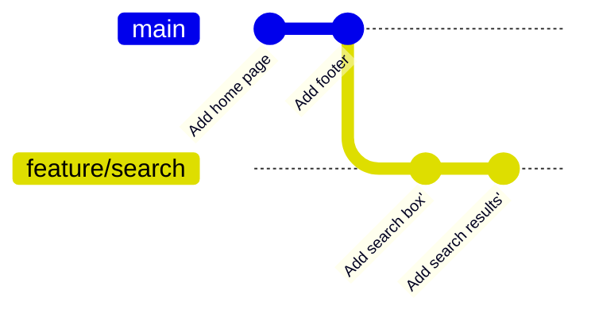

# Module 5 · git rebase: replay your commits on top of the latest main

merge joins histories with a merge commit. rebase instead takes YOUR commits and replays them, one by one, on top of another branch: the result is a straight line, as if you had started your work from the latest main.

```text
git switch feature
git rebase main               replay feature's commits onto main
git rebase --continue         after fixing a conflict
git rebase --abort            give up, back to before the rebase
```

THE GOLDEN RULE: never rebase commits that other people already have (pushed and pulled). Rebasing creates NEW commits with new IDs.

> 🧠 **Picture it:** Cutting your branch off and re-planting it on the newest tip of main.

**Why it matters:** A linear history is easy to read, bisect and revert; many teams require it for pull requests.

## See it



## Try it yourself

Open **Git Bash** (Windows) or a terminal (macOS/Linux) in an empty practice folder and type along. Lines starting with `$` are commands; the lines below them are what Git prints.

```bash
mkdir project && cd project
```

**Setup** (copy and paste this first):

```bash
git init
echo "home" > home.txt
git add home.txt
git commit -m "Add home page"
git switch -c feature/search
echo "search v1" > search.txt
git add search.txt
git commit -m "Add search box"
echo "search v2" > search.txt
git commit -qam "Add search results"
git switch main
echo "footer" > footer.txt
git add footer.txt
git commit -m "Add footer"
```

### 1. Before: feature/search started from an OLD main

```console
$ git log --oneline --graph --all
* ef6f46b Add footer
| * 572f72a Add search results
| * 92be44f Add search box
|/  
* 4397492 Add home page
```

### 2. Rebase: replay the two feature commits on top of the new main

```console
$ git switch feature/search
Switched to branch 'feature/search'
$ git rebase main
Rebasing (1/2)
Rebasing (2/2)
Successfully rebased and updated refs/heads/feature/search.
$ git log --oneline --graph --all
* c5e801a Add search results
* c64e63a Add search box
* ef6f46b Add footer
* 4397492 Add home page
```

The feature commits got NEW IDs: they are new commits with the same changes.

### 3. Now main can fast-forward: a perfectly straight history

```console
$ git switch main
Switched to branch 'main'
$ git merge feature/search
Updating ef6f46b..c5e801a
Fast-forward
 search.txt | 1 +
 1 file changed, 1 insertion(+)
 create mode 100644 search.txt
$ git log --oneline
c5e801a Add search results
c64e63a Add search box
ef6f46b Add footer
4397492 Add home page
```

### 4. A conflict during rebase: fix the file, git add, git rebase --continue

```console
$ git switch -c feature/home
Switched to a new branch 'feature/home'
$ echo "home with banner" > home.txt
$ git commit -qam "Add banner to home"
$ git switch main
Switched to branch 'main'
$ echo "home with menu" > home.txt
$ git commit -qam "Add menu to home"
$ git switch feature/home
Switched to branch 'feature/home'
$ git rebase main
Auto-merging home.txt
CONFLICT (content): Merge conflict in home.txt
Rebasing (1/1)
error: could not apply 6c2cacd... Add banner to home
hint: Resolve all conflicts manually, mark them as resolved with
hint: "git add/rm <conflicted_files>", then run "git rebase --continue".
hint: You can instead skip this commit: run "git rebase --skip".
hint: To abort and get back to the state before "git rebase", run "git rebase --abort".
hint: Disable this message with "git config set advice.mergeConflict false"
Could not apply 6c2cacd... # Add banner to home
```

```bash
cat > home.txt <<'EOF'
home with menu and banner
EOF
```

```console
$ git add home.txt
$ GIT_EDITOR=true git rebase --continue
[detached HEAD 4364aa3] Add banner to home
 1 file changed, 1 insertion(+), 1 deletion(-)
Successfully rebased and updated refs/heads/feature/home.
$ git log --oneline -3
4364aa3 Add banner to home
d1cca52 Add menu to home
c5e801a Add search results
```

> ⚠️ **Watch out:** Conflicts can happen once per replayed commit: fix, git add, git rebase --continue (not git commit).

**In real jobs:** git fetch && git rebase origin/main before opening a pull request.

## Interview question

**merge vs rebase?**

merge keeps the true history with a merge commit; rebase rewrites your commits onto the new base for a linear history. Never rebase shared commits.

[← Back to the module](README.md)
