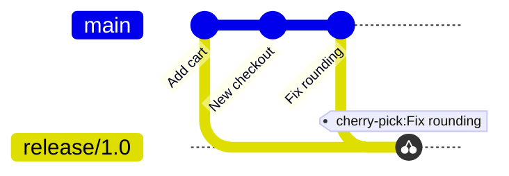

# Module 5 · git cherry-pick: copy ONE commit to another branch

```text
git cherry-pick <commit>     apply the changes of that commit on top of the current branch
```

Typical use: a bug fix landed on main, and the same fix is needed on the release branch that customers are running, without bringing all of main's new features.

> 🧠 **Picture it:** Picking one cherry from another tree and placing it on yours.

**Why it matters:** Hotfixes for older releases are a daily reality in product teams.

## See it



## Try it yourself

Open **Git Bash** (Windows) or a terminal (macOS/Linux) in an empty practice folder and type along. Lines starting with `$` are commands; the lines below them are what Git prints.

```bash
mkdir project && cd project
```

**Setup** (copy and paste this first):

```bash
git init
echo "total = price * qty" > cart.py
git add cart.py
git commit -m "Add cart"
git branch release/1.0
echo "new checkout page" > checkout.py
git add checkout.py
git commit -m "Add new checkout (not released yet)"
echo "total = round(price * qty, 2)" > cart.py
git commit -qam "Fix rounding in cart total"
```

### 1. main has a new feature AND a bug fix. release/1.0 needs only the fix

```console
$ git log --oneline --all --graph
* 9aa8ada Fix rounding in cart total
* 11fe213 Add new checkout (not released yet)
* 8f651f1 Add cart
```

### 2. Copy just the fix

```console
$ git switch release/1.0
Switched to branch 'release/1.0'
$ git cherry-pick -x main
[release/1.0 e967fe6] Fix rounding in cart total
 Date: Tue Oct 27 08:07:00 2026 +0000
 1 file changed, 1 insertion(+), 1 deletion(-)
$ git log --oneline
e967fe6 Fix rounding in cart total
8f651f1 Add cart
$ git log -1 --format=%B
Fix rounding in cart total

(cherry picked from commit 9aa8ada1ba8f2a4b9064868b3a1ae187b6635b5b)
$ cat cart.py
total = round(price * qty, 2)
$ git ls-files
cart.py
```

checkout.py is NOT on the release branch: only the fix came over.

> ⚠️ **Watch out:** The copy is a NEW commit with a new ID; cherry-picking many commits is a sign you should merge or rebase instead.

**In real jobs:** "Backport the fix to release/2.3": git cherry-pick -x <commit>.

## Interview question

**When would you use cherry-pick?**

To copy specific commits (like a hotfix) to another branch without merging everything else; -x records the original commit ID.

[← Back to the module](README.md)
