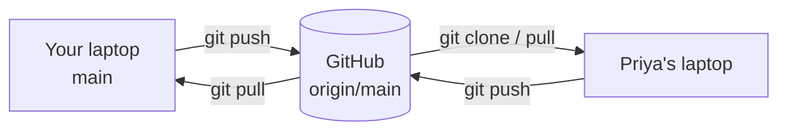

# Module 6 · Remotes: clone, push, pull

A REMOTE is another copy of the repository, usually on GitHub, GitLab or Azure DevOps. "origin" is the default name for the one you cloned from.

```text
git clone <url>                 copy a repository (all history) to your machine
git remote -v                   list remotes
git push -u origin main         send your commits; -u remembers the upstream
git pull                        get teammates' commits (fetch + merge)
```

Here a BARE repository (a repo without a working folder) plays GitHub, so the lesson runs offline. On GitHub the URL looks like git@github.com:you/repo.git.

Connecting to GitHub (one time): SSH    ssh-keygen -t ed25519 -C "you@example.com", add the .pub key on GitHub HTTPS  use a Personal Access Token or the Git Credential Manager

> 🧠 **Picture it:** A shared bookshelf: you take a copy home (clone), add pages, and bring them back (push); you pick up others' pages (pull).

**Why it matters:** Pushing is how your work reaches the team, CI and production; the remote is also your backup.

## See it



## Try it yourself

Open **Git Bash** (Windows) or a terminal (macOS/Linux) in an empty practice folder and type along. Lines starting with `$` are commands; the lines below them are what Git prints.

```bash
mkdir project && cd project
```

### 1. Create 'GitHub' (a bare repo) and push your project to it

```console
$ git init --bare ../github/shop.git
Initialized empty Git repository in ~/github/shop.git/
$ git init
Initialized empty Git repository in ~/project/.git/
$ echo "# Shop" > README.md
$ git add README.md
$ git commit -m "Initial commit"
[main (root-commit) 7cb5715] Initial commit
 1 file changed, 1 insertion(+)
 create mode 100644 README.md
$ git remote add origin ../github/shop.git
$ git remote -v
origin	../github/shop.git (fetch)
origin	../github/shop.git (push)
$ git push -u origin main
branch 'main' set up to track 'origin/main'.
To ../github/shop.git
 * [new branch]      main -> main
```

### 2. A teammate clones it, commits and pushes

```console
$ git clone ../github/shop.git ../priya
Cloning into '../priya'...
done.
$ cd ../priya
$ git log --oneline
7cb5715 Initial commit
$ echo "def pay(): pass" > payments.py
$ git add payments.py
$ git commit -m "Add payments"
[main 366395e] Add payments
 1 file changed, 1 insertion(+)
 create mode 100644 payments.py
$ git push
To ~/github/shop.git
   7cb5715..366395e  main -> main
```

### 3. You pull the teammate's work

```console
$ cd ../project
$ git pull
Updating 7cb5715..366395e
Fast-forward
 payments.py | 1 +
 1 file changed, 1 insertion(+)
 create mode 100644 payments.py
From ../github/shop
   7cb5715..366395e  main       -> origin/main
$ git log --oneline
366395e Add payments
7cb5715 Initial commit
$ git status -sb
## main...origin/main
```

> ⚠️ **Watch out:** Pushing to someone else's repo needs permission; fork it instead (Module 7).

**In real jobs:** Clone with SSH, push your branch, open a pull request.

## Interview question

**What is origin?**

The default name of the remote you cloned from; just an alias for a URL.

[← Back to the module](README.md)
