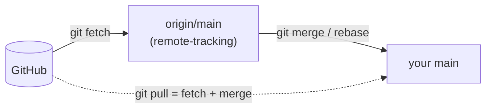

# Module 6 · fetch vs pull, and remote-tracking branches

```text
git fetch          download new commits from the remote; your branches DON'T move.
                   They appear as remote-tracking branches like origin/main.
git pull           git fetch + git merge origin/main (into your current branch)
git pull --rebase  git fetch + git rebase origin/main  (no merge commit)
```

```text
git status -sb     shows "ahead 1, behind 2" compared with the upstream
```

> 🧠 **Picture it:** fetch = the post arrives in your mailbox; pull = you open it and file it into your folder straight away.

**Why it matters:** fetch lets you LOOK before you integrate; knowing ahead/behind avoids surprise merges and rejected pushes.

## See it



## Try it yourself

Open **Git Bash** (Windows) or a terminal (macOS/Linux) in an empty practice folder and type along. Lines starting with `$` are commands; the lines below them are what Git prints.

```bash
mkdir project && cd project
```

**Setup** (copy and paste this first):

```bash
git init --bare ../github/shop.git
git init
echo "# Shop" > README.md
git add README.md
git commit -m "Initial commit"
git remote add origin ../github/shop.git
git push -u origin main
git clone ../github/shop.git ../priya
cd ../priya
echo "def pay(): pass" > payments.py
git add payments.py
git commit -m "Add payments"
git push
cd ../project
echo "def ship(): pass" > shipping.py
git add shipping.py
git commit -m "Add shipping"
```

### 1. fetch: download, but don't touch your branch

```console
$ git fetch
From ../github/shop
   7cb5715..a04f8da  main       -> origin/main
$ git status -sb
## main...origin/main [ahead 1, behind 1]
$ git log --oneline --all --graph
* 04f549f Add shipping
| * a04f8da Add payments
|/  
* 7cb5715 Initial commit
```

### 2. Look before you integrate: what's new on the remote?

```console
$ git log --oneline main..origin/main
a04f8da Add payments
$ git diff --stat main...origin/main
 payments.py | 1 +
 1 file changed, 1 insertion(+)
```

### 3. pull --rebase: integrate without a merge commit

```console
$ git pull --rebase
Rebasing (1/1)
Successfully rebased and updated refs/heads/main.
$ git log --oneline --graph
* 2c77432 Add shipping
* a04f8da Add payments
* 7cb5715 Initial commit
$ git status -sb
## main...origin/main [ahead 1]
$ git push
To ../github/shop.git
   a04f8da..2c77432  main -> main
$ git status -sb
## main...origin/main
```

> ⚠️ **Watch out:** pull merges by default, creating "Merge branch 'main' of ..." commits; many teams set pull.rebase = true.

**In real jobs:** git fetch; git log --oneline main..origin/main to review incoming work.

## Interview question

**git fetch vs git pull?**

fetch downloads and updates origin/* only; pull = fetch + merge (or rebase) into your current branch.

[← Back to the module](README.md)
