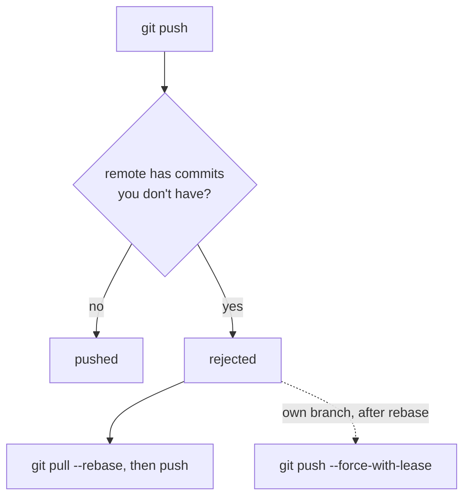

# Module 6 · Rejected pushes, --force and --force-with-lease

If the remote has commits you don't have, git push is REJECTED (non-fast-forward): Git refuses to throw away your teammate's work. Fix: pull (rebase), then push.

After rewriting YOUR OWN branch (rebase, amend), a normal push is also rejected. Then you must force-push:

```text
git push --force             overwrite the remote, no questions asked (dangerous)
git push --force-with-lease  overwrite ONLY if the remote is still where you last
                             saw it; if someone pushed meanwhile, it refuses
```

> 🧠 **Picture it:** --force-with-lease = "replace this page, but only if nobody edited it since I last looked".

**Why it matters:** A careless --force deletes teammates' commits from the server.

## See it



## Try it yourself

Open **Git Bash** (Windows) or a terminal (macOS/Linux) in an empty practice folder and type along. Lines starting with `$` are commands; the lines below them are what Git prints.

```bash
mkdir project && cd project
```

**Setup** (copy and paste this first):

```bash
git init --bare ../github/shop.git
git init
echo "# Shop" > README.md
git add README.md
git commit -m "Initial commit"
git remote add origin ../github/shop.git
git push -u origin main
git switch -c feature/cart
echo "cart v1" > cart.txt
git add cart.txt
git commit -m "Add cart"
git push -u origin feature/cart
git clone ../github/shop.git ../priya
```

### 1. Priya pushed to main meanwhile -> your push to main is rejected

```console
$ cd ../priya
$ echo "def pay(): pass" > payments.py
$ git add payments.py
$ git commit -qm "Add payments"
$ git push
To ~/github/shop.git
   7cb5715..884f472  main -> main
$ cd ../project
$ git switch main
Your branch is up to date with 'origin/main'.
Switched to branch 'main'
$ echo "footer" > footer.txt
$ git add footer.txt
$ git commit -qm "Add footer"
$ git push
To ../github/shop.git
 ! [rejected]        main -> main (fetch first)
error: failed to push some refs to '../github/shop.git'
hint: Updates were rejected because the remote contains work that you do not
hint: have locally. This is usually caused by another repository pushing to
hint: the same ref. If you want to integrate the remote changes, use
hint: 'git pull' before pushing again.
hint: See the 'Note about fast-forwards' in 'git push --help' for details.
```

### 2. The fix: integrate first, then push

```console
$ git pull --rebase
From ../github/shop
   7cb5715..884f472  main       -> origin/main
Rebasing (1/1)
Successfully rebased and updated refs/heads/main.
$ git push
To ../github/shop.git
   884f472..e1e95cb  main -> main
```

### 3. You amended YOUR feature branch -> a force push is needed

```console
$ git switch feature/cart
Your branch is up to date with 'origin/feature/cart'.
Switched to branch 'feature/cart'
$ echo "cart v2" > cart.txt
$ git commit -q -a --amend --no-edit
$ git push
To ../github/shop.git
 ! [rejected]        feature/cart -> feature/cart (non-fast-forward)
error: failed to push some refs to '../github/shop.git'
hint: Updates were rejected because the tip of your current branch is behind
hint: its remote counterpart. If you want to integrate the remote changes,
hint: use 'git pull' before pushing again.
hint: See the 'Note about fast-forwards' in 'git push --help' for details.
```

### 4. ...but a reviewer pushed a commit to your branch first. --force-with-lease protects it

```console
$ cd ../priya
$ git fetch -q
$ git switch feature/cart
branch 'feature/cart' set up to track 'origin/feature/cart'.
Switched to a new branch 'feature/cart'
$ echo "review note" > review.txt
$ git add review.txt
$ git commit -qm "Add review note"
$ git push
To ~/github/shop.git
   8ddee1b..a5424b4  feature/cart -> feature/cart
$ cd ../project
$ git push --force-with-lease
To ../github/shop.git
 ! [rejected]        feature/cart -> feature/cart (stale info)
error: failed to push some refs to '../github/shop.git'
```

Rejected: 'stale info'. Fetch, look at the new commit, rebase onto it, then push again.

> ⚠️ **Watch out:** Never force-push main or other shared branches; protect them on GitHub (branch protection rules).

**In real jobs:** After rebasing your PR branch: git push --force-with-lease.

## Interview question

**Why --force-with-lease instead of --force?**

It refuses to overwrite commits on the remote that you haven't seen, so you can't silently delete a teammate's work.

[← Back to the module](README.md)
