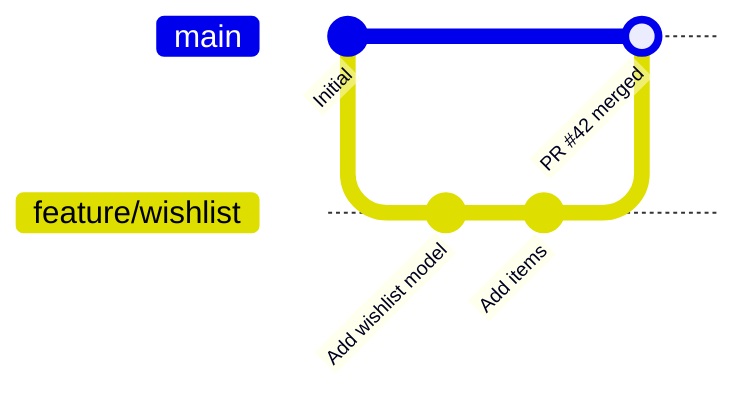

# Module 7 · GitHub flow: how most teams ship code

```text
1. main is always deployable (protected: no direct pushes)
2. git switch -c feature/x from the latest main
3. commit, push the branch, open a Pull Request (PR)
4. CI runs the tests; teammates review and comment
5. merge the PR (merge commit, squash, or rebase), delete the branch
6. main deploys
```

GitHub offers three merge buttons. This lesson shows what each one does to history: Create a merge commit  -> git merge --no-ff Squash and merge       -> git merge --squash + one commit Rebase and merge       -> rebase, then fast-forward

> 🧠 **Picture it:** A restaurant kitchen: dishes (branches) are prepared separately and only reach the customer (main) after the head chef checks them (review + CI).

**Why it matters:** This is the workflow you'll use from your first day in almost any team.

## See it



## Try it yourself

Open **Git Bash** (Windows) or a terminal (macOS/Linux) in an empty practice folder and type along. Lines starting with `$` are commands; the lines below them are what Git prints.

```bash
mkdir project && cd project
```

**Setup** (copy and paste this first):

```bash
git init
echo "# Shop" > README.md
git add README.md
git commit -m "Initial commit"
git switch -c feature/wishlist
echo "wishlist = []" > wishlist.py
git add wishlist.py
git commit -m "Add wishlist model"
echo "def add(item): wishlist.append(item)" >> wishlist.py
git commit -qam "Add items to the wishlist"
git switch main
echo "footer" > footer.txt
git add footer.txt
git commit -m "Add footer"
```

### Create a merge commit (keeps every commit + a merge commit)

```console
$ git merge --no-ff --no-edit feature/wishlist
Merge made by the 'ort' strategy.
 wishlist.py | 2 ++
 1 file changed, 2 insertions(+)
 create mode 100644 wishlist.py
$ git log --oneline --graph
*   6b1f137 Merge branch 'feature/wishlist'
|\  
| * e04d3e4 Add items to the wishlist
| * d23ffd2 Add wishlist model
* | 55c1d7e Add footer
|/  
* 3d365c0 Initial commit
```

**Setup** (copy and paste this first):

```bash
git init
echo "# Shop" > README.md
git add README.md
git commit -m "Initial commit"
git switch -c feature/wishlist
echo "wishlist = []" > wishlist.py
git add wishlist.py
git commit -m "Add wishlist model"
echo "def add(item): wishlist.append(item)" >> wishlist.py
git commit -qam "Add items to the wishlist"
git switch main
echo "footer" > footer.txt
git add footer.txt
git commit -m "Add footer"
```

### Squash and merge (one commit on main)

```console
$ git merge --squash feature/wishlist
Squash commit -- not updating HEAD
Automatic merge went well; stopped before committing as requested
$ git commit -m "Add wishlist (#42)"
[main 878cf6e] Add wishlist (#42)
 1 file changed, 2 insertions(+)
 create mode 100644 wishlist.py
$ git log --oneline --graph
* 878cf6e Add wishlist (#42)
* 55c1d7e Add footer
* 3d365c0 Initial commit
```

**Setup** (copy and paste this first):

```bash
git init
echo "# Shop" > README.md
git add README.md
git commit -m "Initial commit"
git switch -c feature/wishlist
echo "wishlist = []" > wishlist.py
git add wishlist.py
git commit -m "Add wishlist model"
echo "def add(item): wishlist.append(item)" >> wishlist.py
git commit -qam "Add items to the wishlist"
git switch main
echo "footer" > footer.txt
git add footer.txt
git commit -m "Add footer"
```

### Rebase and merge (linear, keeps each commit)

```console
$ git switch feature/wishlist
Switched to branch 'feature/wishlist'
$ git rebase -q main
$ git switch main
Switched to branch 'main'
$ git merge feature/wishlist
Updating 55c1d7e..81ccf81
Fast-forward
 wishlist.py | 2 ++
 1 file changed, 2 insertions(+)
 create mode 100644 wishlist.py
$ git log --oneline --graph
* 81ccf81 Add items to the wishlist
* 9ed066a Add wishlist model
* 55c1d7e Add footer
* 3d365c0 Initial commit
```

After merging, delete the branch on GitHub; teammates run: git fetch --prune

> ⚠️ **Watch out:** Long-lived branches drift from main and end in painful merges: keep PRs small and merge within days.

**In real jobs:** Branch per ticket, PR with a description, green CI, one approval, squash merge.

## Interview question

**Describe your team's Git workflow.**

GitHub flow: short-lived feature branches from main, PRs with CI and code review, squash or merge into a protected main, which deploys.

[← Back to the module](README.md)
