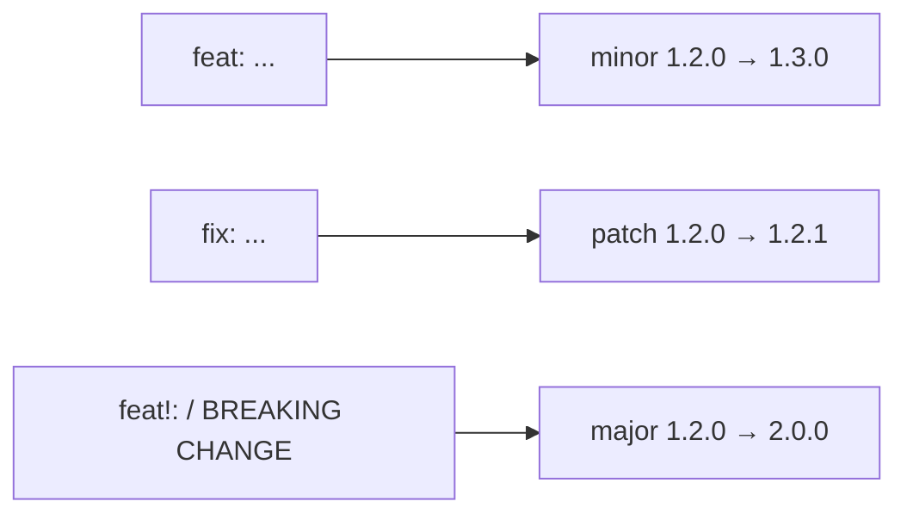

# Module 7 · Commit messages that tools can read: Conventional Commits

Format:   <type>(<optional scope>): <short summary in the imperative>

```text
feat:     a new feature              -> minor version bump (1.2.0 -> 1.3.0)
fix:      a bug fix                  -> patch bump        (1.2.0 -> 1.2.1)
docs:     documentation only
refactor: code change, no behaviour change
test:     tests only
chore:    tooling, dependencies
feat!: or "BREAKING CHANGE:" in the body -> major bump (1.2.0 -> 2.0.0)
```

Good:  fix(cart): round totals to 2 decimals Bad:   fixed stuff / wip / update

This lesson writes a few commits, then builds release notes with nothing but git log --grep, which is exactly what tools like semantic-release automate.

> 🧠 **Picture it:** Labels on moving boxes: "kitchen: plates" beats "stuff".

**Why it matters:** Clear messages make reviews, git log, blame and changelogs useful years later.

## See it



## Try it yourself

Open **Git Bash** (Windows) or a terminal (macOS/Linux) in an empty practice folder and type along. Lines starting with `$` are commands; the lines below them are what Git prints.

```bash
mkdir project && cd project
```

**Setup** (copy and paste this first):

```bash
git init
cat >> cart.py <<'EOF'
# feat(cart): add coupon codes
EOF
git add cart.py
git commit -q -m "feat(cart): add coupon codes"
cat >> cart.py <<'EOF'
# fix(cart): round totals to 2 decimals
EOF
git add cart.py
git commit -q -m "fix(cart): round totals to 2 decimals"
cat >> README.md <<'EOF'
# docs: explain how to run the shop
EOF
git add README.md
git commit -q -m "docs: explain how to run the shop"
cat >> auth.py <<'EOF'
# feat(auth)!: require two-factor login
EOF
git add auth.py
git commit -q -m "feat(auth)!: require two-factor login"
cat >> search.py <<'EOF'
# fix(search): ignore case when matching
EOF
git add search.py
git commit -q -m "fix(search): ignore case when matching"
```

### 1. The history

```console
$ git log --oneline
cbd6dcb fix(search): ignore case when matching
ee8cd9f feat(auth)!: require two-factor login
2f61e2e docs: explain how to run the shop
14eefd2 fix(cart): round totals to 2 decimals
98df997 feat(cart): add coupon codes
```

### 2. Release notes straight from the log: one search per type

```console
$ git log --format="- %s" --grep="^feat"
- feat(auth)!: require two-factor login
- feat(cart): add coupon codes
$ git log --format="- %s" --grep="^fix"
- fix(search): ignore case when matching
- fix(cart): round totals to 2 decimals
$ git log --format="- %s" -E --grep="^[a-z]+(\(.+\))?!:"
- feat(auth)!: require two-factor login
```

The last search finds breaking changes (the ! after the type): the next version is 2.0.0.

Tools like semantic-release or release-please do exactly this automatically in CI.

> ⚠️ **Watch out:** Explain WHY in the body when it isn't obvious; the diff already shows WHAT.

**In real jobs:** Many teams enforce the format with a commit-msg hook or a CI check.

## Interview question

**What makes a good commit message?**

A short imperative summary (~50 chars), a blank line, and a body that explains why; one logical change per commit.

[← Back to the module](README.md)
