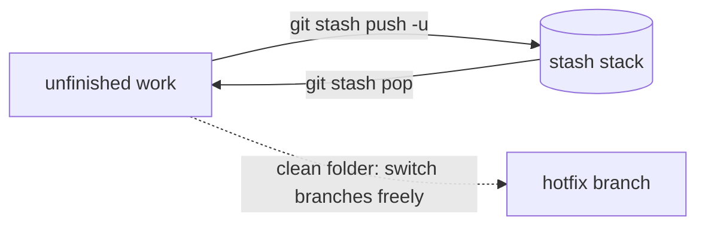

# Module 8 · git stash: put unfinished work aside

You're in the middle of something and must switch branches NOW (urgent bug, reviewer asks for a change). Your work isn't ready to commit.

```text
git stash push -m "msg"      save tracked changes and clean the working tree
git stash push -u -m "msg"   also include UNTRACKED (new) files
git stash list               see the stack of stashes
git stash pop                re-apply the newest stash and drop it
git stash apply stash@{1}    re-apply a specific one and keep it
git stash drop / clear       delete one / all
```

> 🧠 **Picture it:** A drawer: sweep your desk into it, deal with the visitor, then pull everything back out.

**Why it matters:** Interruptions are constant; stash lets you switch context in seconds without junk "WIP" commits.

## See it



## Try it yourself

Open **Git Bash** (Windows) or a terminal (macOS/Linux) in an empty practice folder and type along. Lines starting with `$` are commands; the lines below them are what Git prints.

```bash
mkdir project && cd project
```

**Setup** (copy and paste this first):

```bash
git init
echo "total = sum(items)" > cart.py
git add cart.py
git commit -m "Add cart"
git switch -c hotfix/rounding
echo "total = round(sum(items), 2)" > cart.py
git commit -qam "Fix rounding"
git switch main
```

### 1. Half-done work on main...

```console
$ echo "total = sum(items) - discount" > cart.py
$ echo "def coupon(code): ..." > coupon.py
$ git status --short
 M cart.py
?? coupon.py
```

### 2. ...and an urgent switch. Git refuses: your edit would be overwritten

```console
$ git switch hotfix/rounding
error: Your local changes to the following files would be overwritten by checkout:
	cart.py
Please commit your changes or stash them before you switch branches.
Aborting
```

### 3. Stash it (with -u for the new file), switch, do the urgent work

```console
$ git stash push -u -m "coupon work in progress"
Saved working directory and index state On main: coupon work in progress
$ git status --short
$ git stash list
stash@{0}: On main: coupon work in progress
$ git switch hotfix/rounding
Switched to branch 'hotfix/rounding'
$ cat cart.py
total = round(sum(items), 2)
$ git switch main
Switched to branch 'main'
```

### 4. Back to your work: pop the stash

```console
$ git stash pop
On branch main
Changes not staged for commit:
  (use "git add <file>..." to update what will be committed)
  (use "git restore <file>..." to discard changes in working directory)
	modified:   cart.py

Untracked files:
  (use "git add <file>..." to include in what will be committed)
	coupon.py

no changes added to commit (use "git add" and/or "git commit -a")
Dropped refs/stash@{0} (3adc692c1fa21d2383fa2b1247919ea783d84920)
$ git status --short
 M cart.py
?? coupon.py
$ cat cart.py
total = sum(items) - discount
$ git stash list
```

> ⚠️ **Watch out:** Plain git stash ignores new (untracked) files: use -u. Stashes are local and easy to forget; for anything longer than a day, commit on a branch.

**In real jobs:** git stash -u; fix the hotfix; git stash pop.

## Interview question

**What does git stash do?**

Saves uncommitted changes on a stack and cleans the working tree, so you can switch branches; git stash pop restores them.

[← Back to the module](README.md)
