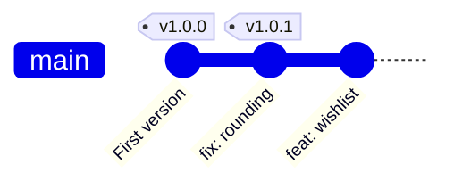

# Module 8 · Tags: name the commits you release

A tag is a permanent name for one commit, usually a version number.

```text
git tag v1.0.0                         lightweight tag: just a name
git tag -a v1.0.0 -m "First release"   ANNOTATED tag: author, date, message (use this)
git tag                                list tags
git show v1.0.0                        the tag and its commit
git push origin v1.0.0                 tags are NOT pushed automatically
git push --follow-tags                 push commits + annotated tags
git describe --tags                    "v1.0.0-2-g1a2b3c" = 2 commits after v1.0.0
```

Semantic Versioning: MAJOR.MINOR.PATCH PATCH  1.0.0 -> 1.0.1   bug fixes only MINOR  1.0.1 -> 1.1.0   new features, backwards compatible MAJOR  1.1.0 -> 2.0.0   breaking changes

> 🧠 **Picture it:** A bookmark with a printed label that never moves (unlike a branch).

**Why it matters:** Releases, deployments and bug reports all refer to versions; a tag ties a version to the exact code.

## See it



## Try it yourself

Open **Git Bash** (Windows) or a terminal (macOS/Linux) in an empty practice folder and type along. Lines starting with `$` are commands; the lines below them are what Git prints.

```bash
mkdir project && cd project
```

**Setup** (copy and paste this first):

```bash
git init --bare ../github/shop.git
git init
git remote add origin ../github/shop.git
echo "shop 1.0" > shop.txt
git add shop.txt
git commit -m "First version of the shop"
```

### 1. Lightweight vs annotated

```console
$ git tag before-launch
$ git tag -a v1.0.0 -m "First public release"
$ git tag
before-launch
v1.0.0
$ git cat-file -t before-launch
commit
$ git cat-file -t v1.0.0
tag
$ git show v1.0.0 --stat
tag v1.0.0
Tagger: Vishal <vishal@example.com>
Date:   Tue Oct 27 08:07:00 2026 +0000

First public release

commit b14578b5ed6f2ff718eedae37b7610b1f7f4ed88
Author: Vishal <vishal@example.com>
Date:   Tue Oct 27 08:05:00 2026 +0000

    First version of the shop

 shop.txt | 1 +
 1 file changed, 1 insertion(+)
```

### 2. More work, a patch release, and git describe

```console
$ echo "fix" > fix.txt
$ git add fix.txt
$ git commit -qm "fix: rounding"
$ git tag -a v1.0.1 -m "Rounding fix"
$ echo "wishlist" > wishlist.txt
$ git add wishlist.txt
$ git commit -qm "feat: wishlist"
$ git describe --tags
v1.0.1-1-g8690ec1
```

### 3. Tags are not pushed with commits

```console
$ git push -q -u origin main
$ git ls-remote --tags origin
$ git push origin --tags
To ../github/shop.git
 * [new tag]         before-launch -> before-launch
 * [new tag]         v1.0.0 -> v1.0.0
 * [new tag]         v1.0.1 -> v1.0.1
$ git ls-remote --tags origin
b14578b5ed6f2ff718eedae37b7610b1f7f4ed88	refs/tags/before-launch
588bc4cd39b799976b742265cd8c0541ca41c369	refs/tags/v1.0.0
b14578b5ed6f2ff718eedae37b7610b1f7f4ed88	refs/tags/v1.0.0^{}
927dce791816c3397994b893b7c3e8d74110b5aa	refs/tags/v1.0.1
d9972e203a88ba04bd6f64adeead90dcd4f84ed8	refs/tags/v1.0.1^{}
```

> ⚠️ **Watch out:** Don't move or delete a tag others have pulled; make a new version instead.

**In real jobs:** Pushing tag v2.3.0 triggers the CI release pipeline and a GitHub Release.

## Interview question

**Lightweight vs annotated tag?**

Lightweight is just a name for a commit; annotated is a full object with tagger, date and message (and can be signed): use it for releases.

[← Back to the module](README.md)
