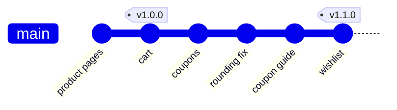

# Module 8 · What changed between two releases?

```text
git log v1.0.0..v1.1.0 --oneline     commits in v1.1.0 that weren't in v1.0.0
git diff --stat v1.0.0 v1.1.0        files changed between the releases
git shortlog -sn v1.0.0..v1.1.0      who contributed, and how much
git log --oneline --no-merges A..B   skip merge commits
```

A GitHub Release = a tag + release notes (+ files to download). Release notes are usually generated from these commands or from Conventional Commits (Module 7).

> 🧠 **Picture it:** Two bookmarks in a book; A..B means "the pages between them".

**Why it matters:** "What's in this release?" is asked by product managers, support and customers every time you ship.

## See it



## Try it yourself

Open **Git Bash** (Windows) or a terminal (macOS/Linux) in an empty practice folder and type along. Lines starting with `$` are commands; the lines below them are what Git prints.

```bash
mkdir project && cd project
```

**Setup** (copy and paste this first):

```bash
git init
cat >> product.txt <<'EOF'
feat: product pages
EOF
git add product.txt
git commit -q -m "feat: product pages" --author="Vishal <vishal@example.com>"
cat >> cart.txt <<'EOF'
feat: cart
EOF
git add cart.txt
git commit -q -m "feat: cart" --author="Vishal <vishal@example.com>"
git tag -a v1.0.0 -m "Release v1.0.0"
cat >> coupons.txt <<'EOF'
feat: coupons
EOF
git add coupons.txt
git commit -q -m "feat: coupons" --author="Priya <priya@example.com>"
cat >> rounding.txt <<'EOF'
fix: rounding in cart
EOF
git add rounding.txt
git commit -q -m "fix: rounding in cart" --author="Vishal <vishal@example.com>"
cat >> coupon.txt <<'EOF'
docs: coupon guide
EOF
git add coupon.txt
git commit -q -m "docs: coupon guide" --author="Priya <priya@example.com>"
cat >> wishlist.txt <<'EOF'
feat: wishlist
EOF
git add wishlist.txt
git commit -q -m "feat: wishlist" --author="Raj <raj@example.com>"
git tag -a v1.1.0 -m "Release v1.1.0"
```

### What's new in v1.1.0?

```console
$ git log --oneline v1.0.0..v1.1.0
cd7a7a0 feat: wishlist
edee8c7 docs: coupon guide
98dec94 fix: rounding in cart
cade2eb feat: coupons
$ git diff --stat v1.0.0 v1.1.0
 coupon.txt   | 1 +
 coupons.txt  | 1 +
 rounding.txt | 1 +
 wishlist.txt | 1 +
 4 files changed, 4 insertions(+)
$ git shortlog -sn v1.0.0..v1.1.0
     2	Priya
     1	Raj
     1	Vishal
```

> ⚠️ **Watch out:** A..B means "reachable from B but not from A": the order matters.

**In real jobs:** CI builds the changelog from git log between the last two tags.

## Interview question

**How do you list the commits between two releases?**

git log v1.0.0..v1.1.0 --oneline (two dots: in the second, not the first).

[← Back to the module](README.md)
