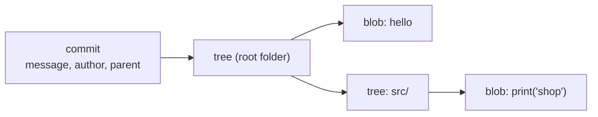

# Module 9 · Inside .git: blobs, trees and commits

Git is a key-value database. Every object is stored under the SHA-1 hash of its content (newer repos can use SHA-256). There are only four object types:

```text
blob     the CONTENT of a file (no name!)
tree     a folder: names -> blobs and other trees
commit   a tree (the snapshot) + parent(s) + author + message
tag      an annotated tag: a name + message pointing to an object
```

```text
git cat-file -t <id>   the type
git cat-file -p <id>   the content, pretty-printed
git hash-object file   the ID a file WOULD get
```

> 🧠 **Picture it:** A library where every book is filed under a fingerprint of its text: identical text = the same fingerprint = stored once.

**Why it matters:** Once you see commits as snapshots pointing to trees and parents, branches, rebase, reset and reflog stop being magic.

## See it



## Try it yourself

Open **Git Bash** (Windows) or a terminal (macOS/Linux) in an empty practice folder and type along. Lines starting with `$` are commands; the lines below them are what Git prints.

```bash
mkdir project && cd project
```

**Setup** (copy and paste this first):

```bash
git init
echo "hello" > a.txt
echo "hello" > copy-of-a.txt
mkdir src
echo "print('shop')" > src/app.py
git add .
git commit -m "First snapshot"
```

### 1. A commit points to a tree, has an author and a message

```console
$ git cat-file -p HEAD
tree 362d89e03cdf686deaa193f9f07649a31e67343b
author Vishal <vishal@example.com> 1793088180 +0000
committer Vishal <vishal@example.com> 1793088180 +0000

First snapshot
```

### 2. The tree is a folder listing: names -> blobs and sub-trees

```console
$ git cat-file -p HEAD^{tree}
100644 blob ce013625030ba8dba906f756967f9e9ca394464a	a.txt
100644 blob ce013625030ba8dba906f756967f9e9ca394464a	copy-of-a.txt
040000 tree 5234dadb279379214f5a218b331d5db0a198db4f	src
$ git ls-tree -r HEAD
100644 blob ce013625030ba8dba906f756967f9e9ca394464a	a.txt
100644 blob ce013625030ba8dba906f756967f9e9ca394464a	copy-of-a.txt
100644 blob 9cf595fed1e892474f91a6d40ebb96d21c66b89d	src/app.py
```

a.txt and copy-of-a.txt share ONE blob: same content, stored once.

### 3. A blob is just the content. Its ID is the hash of that content

```console
$ git cat-file -t ce013625030ba8dba906f756967f9e9ca394464a
blob
$ git cat-file -p ce013625030ba8dba906f756967f9e9ca394464a
hello
$ git hash-object a.txt
ce013625030ba8dba906f756967f9e9ca394464a
```

### 4. Change one file: the new commit reuses every unchanged object

```console
$ echo "print('shop v2')" > src/app.py
$ git commit -qam "Update app"
$ git cat-file -p HEAD
tree b99837d706fd60f40e501bb9ec7fa05de8a24704
parent 2969f603adc3c5eddd26b45ecc364e886a0e2c49
author Vishal <vishal@example.com> 1793088660 +0000
committer Vishal <vishal@example.com> 1793088660 +0000

Update app
$ git ls-tree -r HEAD
100644 blob ce013625030ba8dba906f756967f9e9ca394464a	a.txt
100644 blob ce013625030ba8dba906f756967f9e9ca394464a	copy-of-a.txt
100644 blob 4468d3a57e801eb5af6f274aff0eeae20824641f	src/app.py
$ git count-objects -v
count: 9
size: 0
in-pack: 0
packs: 0
size-pack: 0
prune-packable: 0
garbage: 0
size-garbage: 0
```

> ⚠️ **Watch out:** Git stores snapshots, not diffs: diffs are calculated when you ask (packfiles compress similar objects on disk).

**In real jobs:** Debugging weird repos, understanding why a rebase changes commit IDs.

## Interview question

**Does Git store diffs or snapshots?**

Snapshots: each commit points to a tree of the whole project; unchanged files reuse the same blob, so it stays small.

[← Back to the module](README.md)
