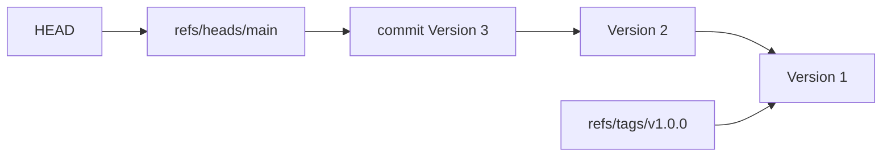

# Module 9 · Refs and HEAD: names for commits

```text
refs/heads/main        a branch: a file with a commit ID
refs/tags/v1.0.0       a tag
refs/remotes/origin/x  a remote-tracking branch
HEAD                   usually "ref: refs/heads/main" (a SYMBOLIC ref)
detached HEAD          HEAD contains a commit ID directly (no branch)
```

Commit expressions: HEAD~1  (= HEAD~)   the first parent        HEAD~3  three generations back HEAD^2              the SECOND parent (of a merge commit) main@{1}            where main was one move ago (reflog)

> 🧠 **Picture it:** Refs are signposts with a commit ID written on them; HEAD is the "you are here" marker standing next to one of the signposts.

**Why it matters:** Every command that takes a commit (reset, diff, log, rebase) accepts these names; and "detached HEAD" stops being scary.

## See it



## Try it yourself

Open **Git Bash** (Windows) or a terminal (macOS/Linux) in an empty practice folder and type along. Lines starting with `$` are commands; the lines below them are what Git prints.

```bash
mkdir project && cd project
```

**Setup** (copy and paste this first):

```bash
git init
echo "v1" > app.txt
git add app.txt
git commit -m "Version 1"
git tag v1.0.0
echo "v2" > app.txt
git commit -qam "Version 2"
echo "v3" > app.txt
git commit -qam "Version 3"
```

### 1. Branches, tags and HEAD are tiny text files

```console
$ cat .git/HEAD
ref: refs/heads/main
$ cat .git/refs/heads/main
2d26991d33f8f45f3628acf14bfc5d776266ff2b
$ git symbolic-ref HEAD
refs/heads/main
$ git show-ref
2d26991d33f8f45f3628acf14bfc5d776266ff2b refs/heads/main
bcf013a339ffca30ac033dc317615cef294a4821 refs/tags/v1.0.0
```

### 2. Naming commits relative to HEAD

```console
$ git rev-parse --short HEAD
2d26991
$ git rev-parse --short HEAD~1
bc33fb9
$ git log -1 --format=%s HEAD~2
Version 1
```

### 3. Detached HEAD: looking at an old version

```console
$ git switch --detach v1.0.0
HEAD is now at bcf013a Version 1
$ cat .git/HEAD
bcf013a339ffca30ac033dc317615cef294a4821
$ git status
HEAD detached at v1.0.0
nothing to commit, working tree clean
$ echo "experiment" > app.txt
$ git commit -qam "Experiment on old version"
$ git switch -c experiment-on-v1
Switched to a new branch 'experiment-on-v1'
$ git log --oneline --all --graph
* 3427e3f Experiment on old version
| * 2d26991 Version 3
| * bc33fb9 Version 2
|/  
* bcf013a Version 1
```

> ⚠️ **Watch out:** Commits made in detached HEAD belong to no branch: create one (git switch -c) before you leave, or find them later in the reflog.

**In real jobs:** git switch --detach v1.2.0 to test an old release.

## Interview question

**What is a detached HEAD?**

HEAD points directly at a commit instead of a branch; new commits there aren't on any branch unless you create one.

[← Back to the module](README.md)
