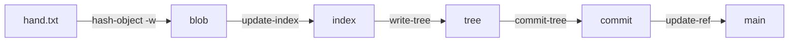

# Module 9 · Build a commit by hand with plumbing commands

The everyday commands (add, commit, branch) are "porcelain". Underneath, Git uses small "plumbing" commands. Doing a commit with them shows exactly what git commit does:

```text
1. git hash-object -w file          store the content as a blob      -> blob ID
2. git update-index --add ...       put blob + name in the index
3. git write-tree                   turn the index into a tree       -> tree ID
4. git commit-tree <tree> -p <parent> -m "msg"                       -> commit ID
5. git update-ref refs/heads/main <commit>   move the branch to it
```

> 🧠 **Picture it:** Building furniture from parts instead of buying it assembled: boards (blobs) -> frame (tree) -> labelled product (commit) -> shelf (ref).

**Why it matters:** If you can explain these five steps, you understand Git better than most people who use it every day.

## See it



## Try it yourself

Open **Git Bash** (Windows) or a terminal (macOS/Linux) in an empty practice folder and type along. Lines starting with `$` are commands; the lines below them are what Git prints.

```bash
mkdir project && cd project
```

**Setup** (copy and paste this first):

```bash
git init
echo "# Shop" > README.md
git add README.md
git commit -m "Initial commit"
```

### 1. Store the content as a blob

```bash
cat > hand.txt <<'EOF'
made with plumbing
EOF
```

```console
$ git hash-object -w hand.txt
1d00f59d814e68d3cbf6f8b74793500b5e916ed0
```

### 2. Put it in the index under a name, 3. write the index as a tree

```console
$ git update-index --add --cacheinfo 100644,1d00f59d814e68d3cbf6f8b74793500b5e916ed0,hand.txt
$ git write-tree
6090a5336cb98585d4646beed4c54b9438588a9f
```

### 4. Create the commit object (parent = current main)

```console
$ git commit-tree 6090a5336cb98585d4646beed4c54b9438588a9f -p 3d365c0 -m "Built by hand"
03e9d59b1d67d2541a22d755ea9a4e54610c854c
```

$ git commit-tree 6090a5336cb98585d4646beed4c54b9438588a9f -p 3d365c0 -m "Built by hand"  
03e9d59b1d67d2541a22d755ea9a4e54610c854c

### 5. Move the branch to the new commit

```console
$ git update-ref refs/heads/main 03e9d59b1d67d2541a22d755ea9a4e54610c854c
$ git log --oneline
03e9d59 Built by hand
3d365c0 Initial commit
$ git show --stat HEAD
commit 03e9d59b1d67d2541a22d755ea9a4e54610c854c
Author: Vishal <vishal@example.com>
Date:   Tue Oct 27 08:10:00 2026 +0000

    Built by hand

 hand.txt | 1 +
 1 file changed, 1 insertion(+)
$ git status --short
```

Exactly what 'git add hand.txt && git commit -m ...' would have done.

> ⚠️ **Watch out:** Plumbing doesn't protect you: update-ref will move a branch anywhere.

**In real jobs:** Plumbing is used in scripts, hooks and CI tools (rev-parse, cat-file, ls-tree).

## Interview question

**What happens when you run git commit?**

Git writes the index as a tree, creates a commit object pointing to that tree and the parent, then moves the current branch to it.

[← Back to the module](README.md)
