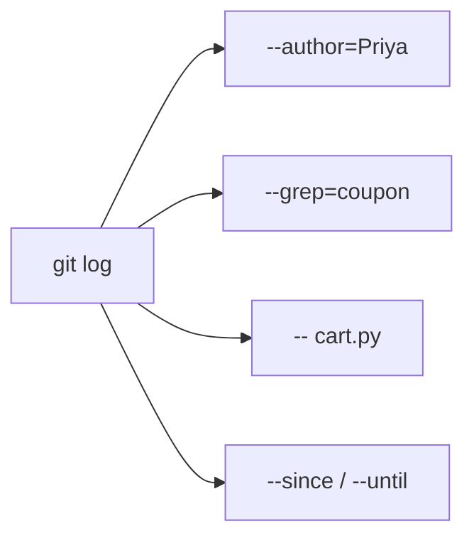

# Module 10 · git log like a detective

```text
git log --oneline --graph --all          the whole picture
git log --author="Priya"                  by person
git log --since="2 weeks ago"             by time (also --until)
git log --grep="coupon" -i                by commit message
git log -- src/cart.py                    commits that touched a file
git log --follow -- cart.py               ...even across renames
git log --format="%h %an %ar %s"          your own format
git shortlog -sn HEAD                     commits per person
```

> 🧠 **Picture it:** The log is a searchable diary; the options are search filters.

**Why it matters:** "When did this change, who did it, and why?" is the first question in every bug investigation.

## See it



## Try it yourself

Open **Git Bash** (Windows) or a terminal (macOS/Linux) in an empty practice folder and type along. Lines starting with `$` are commands; the lines below them are what Git prints.

```bash
mkdir project && cd project
```

**Setup** (copy and paste this first):

```bash
git init
cat >> cart.py <<'EOF'
# Add cart
EOF
git add cart.py
git commit -q -m "Add cart" --author="Vishal <vishal@example.com>"
cat >> coupon.py <<'EOF'
# Add coupon codes
EOF
git add coupon.py
git commit -q -m "Add coupon codes" --author="Priya <priya@example.com>"
cat >> cart.py <<'EOF'
# Fix rounding in cart
EOF
git add cart.py
git commit -q -m "Fix rounding in cart" --author="Vishal <vishal@example.com>"
cat >> README.md <<'EOF'
# Document coupons
EOF
git add README.md
git commit -q -m "Document coupons" --author="Raj <raj@example.com>"
cat >> coupon.py <<'EOF'
# Coupon: expire after 30 days
EOF
git add coupon.py
git commit -q -m "Coupon: expire after 30 days" --author="Priya <priya@example.com>"
cat >> search.py <<'EOF'
# Add search
EOF
git add search.py
git commit -q -m "Add search" --author="Vishal <vishal@example.com>"
```

### 1. Filter by person, message and file

```console
$ git log --oneline --author=Priya
4034e86 Coupon: expire after 30 days
3629b31 Add coupon codes
$ git log --oneline -i --grep=coupon
4034e86 Coupon: expire after 30 days
e0d95c2 Document coupons
3629b31 Add coupon codes
$ git log --oneline -- cart.py
766dba7 Fix rounding in cart
e426c38 Add cart
```

### 2. Your own format, and a summary per person

```console
$ git log -3 --format="%h | %an | %ad | %s" --date=format:%H:%M
a0f17f1 | Vishal | 08:13 | Add search
4034e86 | Priya | 08:11 | Coupon: expire after 30 days
e0d95c2 | Raj | 08:09 | Document coupons
$ git shortlog -sn HEAD
     3	Vishal
     2	Priya
     1	Raj
```

### 3. Time filters (the sandbox clock starts at 08:00 on 27 Oct 2026)

```console
$ git log --oneline --since="2026-10-27 08:10 +0000" --until="2026-10-27 08:12 +0000"
4034e86 Coupon: expire after 30 days
```

> ⚠️ **Watch out:** A..B ranges and path filters combine: git log main..feature -- api/

**In real jobs:** Finding which release introduced a change; preparing release notes.

## Interview question

**How do you find all commits that touched a file?**

git log --follow -- path (add -p to see the changes).

[← Back to the module](README.md)
