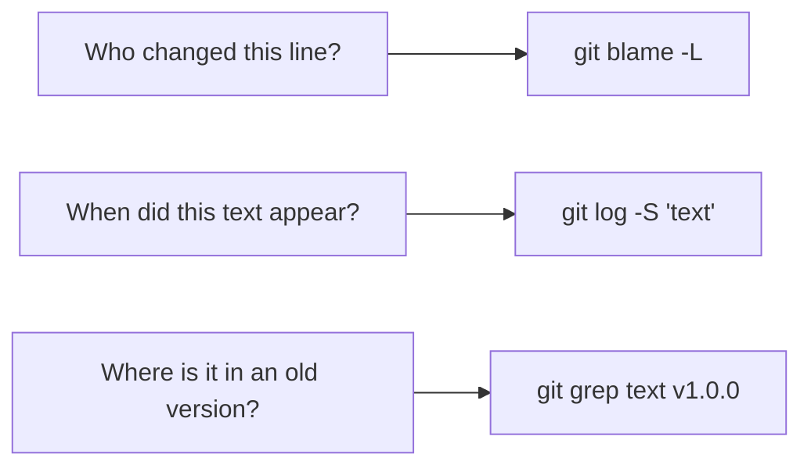

# Module 10 · Who changed this line, and when did this code appear?

```text
git blame -L 2,4 cart.py      last commit + author for each line (lines 2-4)
git log -S "discount" -p      the PICKAXE: commits that added or removed this text
git log -G "rate\s*="         commits whose diff matches a regex
git grep -n "TODO"            search the current files (fast, respects .gitignore)
git grep "SECRET" v1.0.0      search an old version
```

> 🧠 **Picture it:** blame = "who wrote this sentence"; pickaxe = "in which edition was this word first printed (or removed)".

**Why it matters:** To fix a bug well you need the context: which commit, which ticket, and what the author intended.

## See it



## Try it yourself

Open **Git Bash** (Windows) or a terminal (macOS/Linux) in an empty practice folder and type along. Lines starting with `$` are commands; the lines below them are what Git prints.

```bash
mkdir project && cd project
```

**Setup** (copy and paste this first):

```bash
git init
cat > cart.py <<'EOF'
def total(items):
    return sum(items)
EOF
git add cart.py
git commit -q -m "Add cart" --author="Vishal <vishal@example.com>"
cat > cart.py <<'EOF'
def total(items, discount=0):
    rate = 1 - discount
    return sum(items) * rate
EOF
git add cart.py
git commit -q -m "Add discount" --author="Priya <priya@example.com>"
cat > cart.py <<'EOF'
def total(items, discount=0):
    rate = 1 - min(discount, 0.5)
    return sum(items) * rate
EOF
git add cart.py
git commit -q -m "Cap discount at 50%" --author="Raj <raj@example.com>"
```

### 1. blame: who last changed each line?

```console
$ git blame -s -L 1,3 cart.py
c2a7a6f3 1) def total(items, discount=0):
b863aded 2)     rate = 1 - min(discount, 0.5)
c2a7a6f3 3)     return sum(items) * rate
$ git blame --date=short -L 2,2 cart.py
b863aded (Raj 2026-10-27 2)     rate = 1 - min(discount, 0.5)
```

### 2. The pickaxe: when did 'discount' appear? When did 'min(' appear?

```console
$ git log --oneline -S discount
c2a7a6f Add discount
$ git log --oneline -S "min("
b863ade Cap discount at 50%
```

### 3. git grep: search the code, now and in the past

```console
$ git grep -n rate
cart.py:2:    rate = 1 - min(discount, 0.5)
cart.py:3:    return sum(items) * rate
$ git grep -n rate HEAD~1
HEAD~1:cart.py:2:    rate = 1 - discount
HEAD~1:cart.py:3:    return sum(items) * rate
```

> ⚠️ **Watch out:** blame shows the LAST change to a line; a reformat commit hides the real author: use --ignore-rev or follow up with log -S.

**In real jobs:** blame a weird line -> open the commit -> read the PR -> understand why.

## Interview question

**How do you find when a piece of code was added or removed?**

git log -S "text" (pickaxe) or -G for a regex; git blame for each line's last change.

[← Back to the module](README.md)
