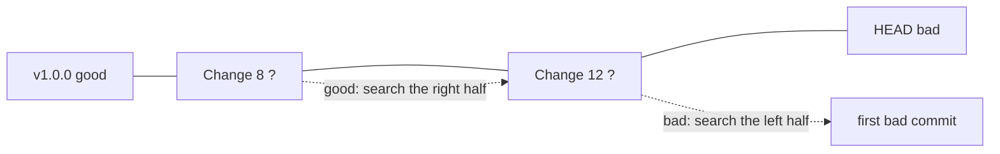

# Module 10 · git bisect: binary search for the commit that broke something

"It worked in v1.0, it's broken now, and there are 200 commits in between." bisect asks you good/bad about the middle commit, halves the range, and finds the first bad commit in about log2(200) = 8 steps.

```text
git bisect start
git bisect bad                 the current commit is broken
git bisect good v1.0.0         this one was fine
...test, then: git bisect good / git bisect bad ...
git bisect reset               back to where you started
```

```text
git bisect run <test command>  fully automatic: exit code 0 = good, 1-127 = bad
                               (here: sh check_price.sh, a one-line grep)
```

> 🧠 **Picture it:** The number-guessing game: "higher or lower?" halves the possibilities each time.

**Why it matters:** It turns a day of guessing into minutes, even in histories you don't know.

## See it



## Try it yourself

Open **Git Bash** (Windows) or a terminal (macOS/Linux) in an empty practice folder and type along. Lines starting with `$` are commands; the lines below them are what Git prints.

```bash
mkdir project && cd project
```

**Setup** (copy and paste this first):

```bash
git init
printf '#!/bin/sh\ngrep -q "1.19" price.txt\n' > check_price.sh
for i in $(seq 1 16); do
  if [ $i -ge 11 ]; then rate=1.91; else rate=1.19; fi   # change 11 swaps two digits: the bug
  echo "gross = net * $rate" > price.txt
  echo "change $i" >> CHANGELOG.txt
  git add . && git commit -q -m "Change $i"
done
git tag v1.0.0 HEAD~15
```

### 1. 16 commits; v1.0.0 (the first) was fine, HEAD is broken

```console
$ git log --oneline -3
6267dfb Change 16
a98d173 Change 15
e971b04 Change 14
$ cat price.txt
gross = net * 1.91
$ git bisect start HEAD v1.0.0
Bisecting: 7 revisions left to test after this (roughly 3 steps)
[9e65977b382c1b4dd09b7fbfcb3ad8f669bf4012] Change 8
```

### 2. Let Git find it: run the check script on each step automatically

```console
$ git bisect run sh check_price.sh
running 'sh' 'check_price.sh'
Bisecting: 3 revisions left to test after this (roughly 2 steps)
[9bbaa46f488076d48478d4f2803a92f2a50277eb] Change 12
running 'sh' 'check_price.sh'
Bisecting: 1 revision left to test after this (roughly 1 step)
[2b130586eb34523b821e235cccd03ef61d823aa0] Change 10
running 'sh' 'check_price.sh'
Bisecting: 0 revisions left to test after this (roughly 0 steps)
[11866678d421c5c4b37c4c2ad6df37ac9c0e4d73] Change 11
running 'sh' 'check_price.sh'
11866678d421c5c4b37c4c2ad6df37ac9c0e4d73 is the first 'bad' commit
commit 11866678d421c5c4b37c4c2ad6df37ac9c0e4d73
Author: Vishal <vishal@example.com>
Date:   Tue Oct 27 08:23:00 2026 +0000

    Change 11

 CHANGELOG.txt | 1 +
 price.txt     | 2 +-
 2 files changed, 2 insertions(+), 1 deletion(-)
bisect found first 'bad' commit
$ git bisect reset
Previous HEAD position was 1186667 Change 11
Switched to branch 'main'
```

Found in 4 steps instead of checking 16 commits one by one.

> ⚠️ **Watch out:** Always finish with git bisect reset. And the test must be reliable: a flaky test sends bisect the wrong way.

**In real jobs:** A regression found in production: bisect between the last good release tag and HEAD with a small script that reproduces it.

## Interview question

**How do you find which commit introduced a bug?**

git bisect between a known good and bad commit, ideally with git bisect run and a test that reproduces the bug.

[← Back to the module](README.md)
