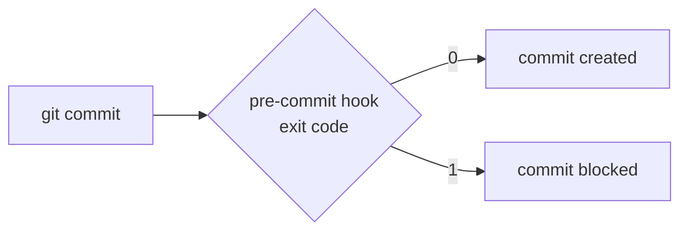

# Module 11 · Git hooks: scripts that run automatically

Hooks are scripts in .git/hooks/ that Git runs at certain moments. If a hook exits with a non-zero code, Git stops the action.

```text
pre-commit   before a commit is created   -> block secrets, run the linter
commit-msg   checks the message           -> enforce Conventional Commits
pre-push     before pushing               -> run the tests
```

Hooks live in .git/, so they are NOT shared by cloning. Teams share them with the pre-commit framework (https://pre-commit.com) or core.hooksPath.

> 🧠 **Picture it:** A security guard at the door: every commit is checked on the way out.

**Why it matters:** The cheapest place to catch a leaked password or a lint error is on the developer's laptop, before it reaches the server.

## See it



## Try it yourself

Open **Git Bash** (Windows) or a terminal (macOS/Linux) in an empty practice folder and type along. Lines starting with `$` are commands; the lines below them are what Git prints.

```bash
mkdir project && cd project
```

**Setup** (copy and paste this first):

```bash
git init
echo "# Shop" > README.md
git add README.md
git commit -m "Initial commit"
```

### 1. A pre-commit hook that blocks secrets

```bash
cat > .git/hooks/pre-commit <<'EOF'
#!/bin/sh
if git diff --cached | grep -qE "(PASSWORD|SECRET|API_KEY)="; then
  echo "pre-commit: a secret is staged. Commit blocked."
  exit 1
fi
EOF
```

```console
$ chmod +x .git/hooks/pre-commit
$ cat .git/hooks/pre-commit
#!/bin/sh
if git diff --cached | grep -qE "(PASSWORD|SECRET|API_KEY)="; then
  echo "pre-commit: a secret is staged. Commit blocked."
  exit 1
fi
$ echo "API_KEY=sk_live_123" > settings.py
$ git add settings.py
$ git commit -m "Add settings"
pre-commit: a secret is staged. Commit blocked.
$ git log --oneline
3d365c0 Initial commit
```

### 2. A commit-msg hook that enforces Conventional Commits

```bash
cat > .git/hooks/commit-msg <<'EOF'
#!/bin/sh
if ! head -1 "$1" | grep -qE "^(feat|fix|docs|refactor|test|chore)(\(.+\))?!?: .+"; then
  echo "commit-msg: use 'type(scope): summary', e.g. 'fix(cart): round totals'"
  exit 1
fi
EOF
```

```console
$ chmod +x .git/hooks/commit-msg
$ echo "API_KEY = os.environ['API_KEY']" > settings.py
$ git add settings.py
$ git commit -m "stuff"
commit-msg: use 'type(scope): summary', e.g. 'fix(cart): round totals'
$ git commit -m "feat(settings): read the API key from the environment"
[main f51c2d6] feat(settings): read the API key from the environment
 1 file changed, 1 insertion(+)
 create mode 100644 settings.py
$ git log --oneline
f51c2d6 feat(settings): read the API key from the environment
3d365c0 Initial commit
```

Bypass (careful!): git commit --no-verify. That's why CI must run the same checks.

> ⚠️ **Watch out:** Hooks can be skipped with --no-verify, so CI must run the same checks.

**In real jobs:** pre-commit with ruff, black, detect-secrets; CI runs pre-commit too.

## Interview question

**What are Git hooks?**

Scripts Git runs on events like pre-commit or pre-push; a non-zero exit blocks the action. Shared via the pre-commit framework or core.hooksPath.

[← Back to the module](README.md)
