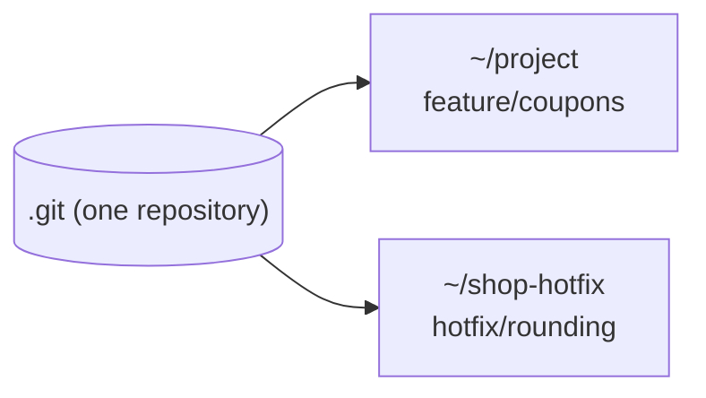

# Module 11 · git worktree: two branches checked out at the same time

Stash is fine for a quick switch. When you need to work on a hotfix while your feature branch keeps running (a dev server, a long test run), use a worktree: a second folder linked to the SAME repository, with a different branch checked out.

```text
git worktree add ../shop-hotfix hotfix/rounding     new folder on that branch
git worktree list
git worktree remove ../shop-hotfix
```

> 🧠 **Picture it:** Two desks in the same office, sharing one filing cabinet (.git).

**Why it matters:** No stashing, no lost context, no re-installing dependencies: each task gets its own folder.

## See it



## Try it yourself

Open **Git Bash** (Windows) or a terminal (macOS/Linux) in an empty practice folder and type along. Lines starting with `$` are commands; the lines below them are what Git prints.

```bash
mkdir project && cd project
```

**Setup** (copy and paste this first):

```bash
git init
echo "total = sum(items)" > cart.py
git add cart.py
git commit -m "Add cart"
git branch hotfix/rounding
git switch -c feature/coupons
echo "half-finished coupon work" > coupon.py
```

### 1. Mid-feature, with uncommitted work... open the hotfix in a second folder

```console
$ git status --short
?? coupon.py
$ git worktree add ../shop-hotfix hotfix/rounding
HEAD is now at dd073e8 Add cart
Preparing worktree (checking out 'hotfix/rounding')
$ git worktree list
~/project     dd073e8 [feature/coupons]
~/shop-hotfix dd073e8 [hotfix/rounding]
```

### 2. Fix the bug over there; your feature folder is untouched

```console
$ cd ../shop-hotfix
$ echo "total = round(sum(items), 2)" > cart.py
$ git commit -qam "fix: round totals"
$ git log --oneline -1
02eb3c7 fix: round totals
$ cd ../project
$ git status --short
?? coupon.py
$ git log --oneline -1 hotfix/rounding
02eb3c7 fix: round totals
```

### 3. Clean up

```console
$ git worktree remove ../shop-hotfix
$ git worktree list
~/project dd073e8 [feature/coupons]
```

> ⚠️ **Watch out:** A branch can be checked out in only one worktree at a time.

**In real jobs:** Reviewing a colleague's PR in a separate folder while your own work stays open.

## Interview question

**stash vs worktree?**

stash shelves changes so you can switch in the same folder; a worktree gives another branch its own folder at the same time.

[← Back to the module](README.md)
