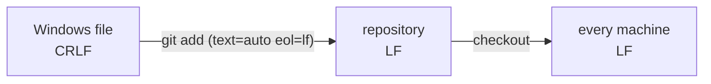

# Module 11 · Line endings and .gitattributes

Windows ends lines with CRLF (\r\n), macOS and Linux with LF (\n). Without rules, a mixed team produces diffs where EVERY line changed, and shell scripts break on Linux.

The fix is a .gitattributes file in the repository (shared with everyone):

```text
* text=auto eol=lf      normalise text files to LF in the repo and checkout
*.bat text eol=crlf     Windows scripts keep CRLF
*.png binary            never touch images
*.lock -diff            don't show diffs for generated files
```

```text
git ls-files --eol           what's stored vs what's in your folder
git add --renormalize .      apply new rules to existing files
```

> 🧠 **Picture it:** Two keyboards with different Enter keys; .gitattributes says which one everybody's files use.

**Why it matters:** "I changed one line but the diff shows 500" is almost always line endings.

## See it



## Try it yourself

Open **Git Bash** (Windows) or a terminal (macOS/Linux) in an empty practice folder and type along. Lines starting with `$` are commands; the lines below them are what Git prints.

```bash
mkdir project && cd project
```

**Setup** (copy and paste this first):

```bash
git init
printf 'echo deploying\r\necho done\r\n' > deploy.sh
```

### 1. Someone on Windows commits a CRLF file

```console
$ git add deploy.sh
$ git commit -qm "Add deploy script"
$ git ls-files --eol
i/crlf  w/crlf  attr/                 	deploy.sh
```

### 2. Add .gitattributes and renormalise: the repo now stores LF

```bash
cat > .gitattributes <<'EOF'
* text=auto eol=lf
*.bat text eol=crlf
*.png binary
EOF
```

```console
$ cat .gitattributes
* text=auto eol=lf
*.bat text eol=crlf
*.png binary
$ git add --renormalize .
$ git add .gitattributes
$ git commit -qm "Normalise line endings"
$ git ls-files --eol
i/lf    w/lf    attr/text=auto eol=lf 	.gitattributes
i/lf    w/crlf  attr/text=auto eol=lf 	deploy.sh
$ git check-attr -a deploy.sh
deploy.sh: text: auto
deploy.sh: eol: lf
```

### 3. Your folder still has the old CRLF copy; check it out again

```console
$ rm deploy.sh
$ git restore deploy.sh
$ git ls-files --eol deploy.sh
i/lf    w/lf    attr/text=auto eol=lf 	deploy.sh
```

> ⚠️ **Watch out:** core.autocrlf is a personal setting; .gitattributes is the team rule and wins.

**In real jobs:** Every cross-platform repo should have a .gitattributes on day one.

## Interview question

**How do you handle line endings in a team with Windows and Linux?**

A .gitattributes with "* text=auto eol=lf" (plus exceptions), and git add --renormalize . once.

[← Back to the module](README.md)
