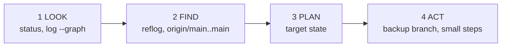

# Module 12 · Capstone walkthrough: how to rescue any messy repository

When a repository is in a strange state, don't type commands at random. Follow the same four steps every time:

```text
1. LOOK      git status -sb · git log --oneline --graph --all · git stash list
2. FIND      git reflog (where was I?) · git log origin/main..main (what's unpushed?)
3. PLAN      what should main / my branch / the remote look like at the end?
4. ACT       small, reversible steps; check with git log after each one
```

This walkthrough fixes the most common mess: you committed to main by mistake, and meanwhile a teammate pushed to main.

> 🧠 **Picture it:** A doctor: look at the symptoms, check the history, decide on a treatment, then treat one step at a time.

**Why it matters:** Calmly fixing a broken repo is what makes people trust you with the production branch.

## See it



## Try it yourself

Open **Git Bash** (Windows) or a terminal (macOS/Linux) in an empty practice folder and type along. Lines starting with `$` are commands; the lines below them are what Git prints.

```bash
mkdir project && cd project
```

**Setup** (copy and paste this first):

```bash
git init --bare ../github/shop.git
git init
echo "# Shop" > README.md
git add README.md
git commit -m "Initial commit"
git remote add origin ../github/shop.git
git push -q -u origin main
git clone -q ../github/shop.git ../priya
cd ../priya
echo "total = round(sum(items), 2)" > cart.py
git add cart.py
git commit -qm "fix: round totals"
git push -q
cd ../project
echo "wishlist = []" > wishlist.py
git add wishlist.py
git commit -m "Add wishlist"
```

### 1. LOOK

```console
$ git status -sb
## main...origin/main [ahead 1]
$ git fetch
From ../github/shop
   7cb5715..e6f6181  main       -> origin/main
$ git status -sb
## main...origin/main [ahead 1, behind 1]
$ git log --oneline --graph --all
* 76eaf96 Add wishlist
| * e6f6181 fix: round totals
|/  
* 7cb5715 Initial commit
```

### 2. FIND: what's mine and unpushed?

```console
$ git log --oneline origin/main..main
76eaf96 Add wishlist
```

### 3. PLAN: main = origin/main; my commit on feature/wishlist, on top of the latest main

### 4. ACT, one safe step at a time

```console
$ git branch backup
$ git branch feature/wishlist
$ git reset --hard origin/main
HEAD is now at e6f6181 fix: round totals
$ git log --oneline
e6f6181 fix: round totals
7cb5715 Initial commit
$ git switch feature/wishlist
Switched to branch 'feature/wishlist'
$ git rebase main
Rebasing (1/1)
Successfully rebased and updated refs/heads/feature/wishlist.
$ git log --oneline --graph --all
* 4f1391c Add wishlist
* e6f6181 fix: round totals
| * 76eaf96 Add wishlist
|/  
* 7cb5715 Initial commit
$ git push -u origin feature/wishlist
branch 'feature/wishlist' set up to track 'origin/feature/wishlist'.
To ../github/shop.git
 * [new branch]      feature/wishlist -> feature/wishlist
$ git branch -D backup
Deleted branch backup (was 76eaf96).
```

Done: main matches the team, your work sits on its own branch, ready for a pull request.

> ⚠️ **Watch out:** Before anything risky, make a safety branch: git branch backup. It costs nothing and makes every mistake reversible.

**In real jobs:** "I committed to main!", "my branch is 40 commits behind", "the push is rejected": everyday Slack messages you'll be able to answer.

## Interview question

**You committed to main instead of a feature branch. Fix it.**

git branch feature/x (keeps the commit), git reset --hard origin/main on main, then continue on feature/x (rebase it if main moved).

[← Back to the module](README.md)
